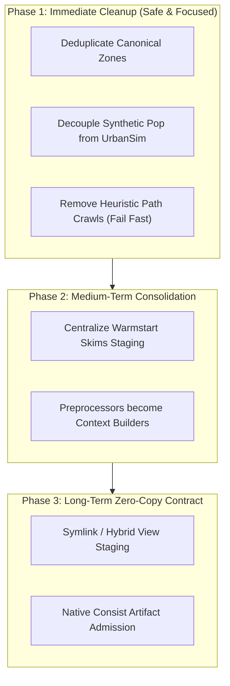

# PILATES Staging Pipeline Simplification & Cleanup Plan

- **Date:** 2026-10-20
- **Status:** Proposed
- **Context:** Architectural review following Lawrencium HPC SFBay smoke run fixes (`edf64209`)

---

## 1. Executive Summary & Motivation

During execution of the SFBay supply-demand loop run on Lawrencium HPC (`job 27120756`), bootstrap initialization crashed because `UrbansimPreprocessor.copy_data_to_mutable_location` unconditionally attempted to copy `pilates/beam/production/sfbay/skims.omx`, despite `models.land_use` being explicitly disabled (`null`).

The immediate fix in commit `edf64209` prevented the crash by skipping the skims copy when `land_use_enabled` is false and adding fallback staging in `BeamPreprocessor`. However, an architectural review revealed that this patch addresses a symptom of a deeper design issue:

> **Core Architectural Anti-pattern:** Preprocessors currently act as opportunistic "data vacuums" that search for files across fallback directories, rather than having bounded, declarative input staging with clear artifact ownership.

This plan details a phased strategy to eliminate redundant file operations, cleanly decouple model preprocessors, remove heuristic path searches, and transition to a declarative, zero-copy staging model backed by Consist.

---

## 2. Identified Anti-Patterns & Technical Debt

### 2.1 Redundant Staging (Accidental Duplication)
- **Canonical Zones:** Handled twice during bootstrap:
  1. [`pilates/generic/initialization.py`](file:///Users/zaneedell/git/PILATES/pilates/generic/initialization.py#L338-L390) copies canonical zones to `<workspace>/activitysim/data/` if BEAM and ActivitySim are enabled.
  2. [`pilates/activitysim/preprocessor.py`](file:///Users/zaneedell/git/PILATES/pilates/activitysim/preprocessor.py#L2980-L3005) repeats the exact same copy when `_copy_data_to_mutable_location` is invoked.

### 2.2 Entangled Ownership & Leaky Boundaries
- **Synthetic Population tied to UrbanSim:** The synthetic population (`custom_mpo_*.h5`) is a primary input to ActivitySim, but its staging is owned by `UrbansimPreprocessor`. 
- To provide this file to ActivitySim when UrbanSim is disabled, [`GenericInitialization.run`](file:///Users/zaneedell/git/PILATES/pilates/generic/initialization.py#L433-L453) artificially invokes `usim_preprocessor.copy_data_to_mutable_location(...)`.
- This pulls in UrbanSim-specific requirements (such as UrbanSim's expected copy of BEAM skims) even for runs that do not involve land-use modeling.

### 2.3 Disjointed Skim Staging
- Staging of initial/warmstart skims is currently scattered across three locations:
  1. `BeamPreprocessor.copy_data_to_mutable_location` copies initial skims into `<workspace>/beam/input/{region}/`.
  2. `UrbansimPreprocessor.copy_data_to_mutable_location` copies initial skims into `<workspace>/urbansim/data/`.
  3. `activitysim.admission.resolve_bootstrap_activitysim_skims_path` searches between mutable ActivitySim and BEAM folders to decide which candidate to evaluate.

### 2.4 Heuristic Path Probing vs. Fail-Fast
- When an input is not found at the configured location, preprocessors execute heuristic crawls:
  - `_find_beam_production_path` falls back to `sources/PILATES/` and relative directory scanning.
  - `UrbansimPreprocessor` searches `pilates/activitysim/data/{region}/` as a fallback.
  - `BeamPreprocessor` falls back to scanning relative repository roots.
- **Problem:** Heuristic fallbacks mask configuration errors, produce environment-dependent behavior between local machines and HPC clusters, and weaken reproducibility.

### 2.5 Provenance Back-Filling
- Rather than Consist declaring and verifying input identities up-front from validated configurations, files are discovered on disk and then searched for sibling `.provenance.json` sidecars to backfill records.

---

## 3. Phased Implementation Roadmap



---

### Phase 1: Immediate Cleanup (Targeted, Low Risk)

**Goal:** Eliminate obvious duplications and decouple synthetic population staging without breaking existing runner contracts.

1. **Deduplicate Canonical Zones Staging:**
   - Remove the zone copying block in `GenericInitialization.run` (`lines 337–410`).
   - Ensure `ActivitySimPreprocessor._copy_data_to_mutable_location` remains the single, authoritative stage for copying canonical zones into `<workspace>/activitysim/data/`.
   - Verify that zone provenance records continue to log cleanly to `initialization_records_in` and `initialization_records_out`.

2. **Decouple Synthetic Population Staging from UrbanSim:**
   - Create a dedicated helper `stage_synthetic_population(settings, workspace)` in `pilates/generic/initialization.py` or `pilates/activitysim/preprocessor.py`.
   - When `models.land_use` is disabled, stage the synthetic population HDF5 directly into `<workspace>/urbansim/data/` (or `<workspace>/activitysim/data/`) without invoking `UrbansimPreprocessor`.
   - Keep `UrbansimPreprocessor.copy_data_to_mutable_location` strictly scoped to runs where `models.land_use` is active.

3. **Purge Heuristic Path Probing (Enforce Fail-Fast):**
   - Remove legacy fallback paths that probe `sources/PILATES/` or look for files in sibling model directories.
   - If an input file specified in the configuration (`settings.beam.local_input_folder`, `settings.urbansim.local_data_input_folder`, etc.) does not exist, raise an immediate, informative `ConfigurationError` specifying the missing path and required config key.

---

### Phase 2: Medium-Term Consolidation (Single Responsibility)

**Goal:** Make input staging declarative and centralized in bootstrap.

1. **Centralize Initial / Warmstart Skim Staging:**
   - Extract initial skim staging out of `BeamPreprocessor` and `UrbansimPreprocessor`.
   - In `GenericInitialization` (or a dedicated `StagingManager`), stage `skims.omx` exactly once based on `settings.shared.skims` and `settings.activitysim.admission.initial_skims`.
   - Downstream models consume the single staged skim path via standard workspace resolution (`workspace.get_initial_skims_path()`).

2. **Refactor Preprocessors to Context Builders:**
   - Preprocessors should focus on their core purpose: resolving parameter dictionaries, validating schemas, creating container command lines, and generating model configs.
   - File copying should be handled by a unified staging mechanism that consumes a declarative list of `(source_path, target_path, short_name)` descriptors.

---

### Phase 3: Long-Term Zero-Copy & Consist Native Contract

**Goal:** Zero physical data duplication and native Consist artifact binding.

1. **Zero-Copy Staging for Static Inputs:**
   - Multi-gigabyte static inputs (e.g. 5GB+ full skims, synthetic population HDF5, linkstats parquet) should not be physically copied across network filesystems using `shutil.copy2`.
   - Utilize symlinks or read-only container bind-mounts pointing to the canonical archive or input repository.
   - Only files that require in-place mutation (e.g., config templates with interpolated seeds) are copied into mutable scratch directories.

2. **Explicit Consist Artifact Identifiers:**
   - Migrate settings files from ambiguous path strings to explicit Consist artifact keys:
     ```yaml
     shared:
       skims:
         artifact_id: "sha256:347d8b2f1459ec2c1751e6d3f33730a8923c9c82b1ca6458f82930c5cd01eb8f"
         declared_source: "scenarios/sfbay/data/skims.omx"
     ```
   - Consist verifies content digests at admission time natively, rendering ad-hoc `.provenance.json` sidecar crawling obsolete.

---

## 4. Verification & Testing Strategy

Each phase must maintain backwards compatibility and pass the existing test suite:

1. **Bootstrap & Staging Tests:**
   - `tests/test_bootstrap_skim_staging.py`: Validate that staging succeeds when land use is disabled and raises cleanly when required inputs are missing.
   - `tests/test_initialization.py`: Validate that deduplicated canonical zones and synthetic population staging produce the exact expected records.
2. **Admission & Regression Suites:**
   - `tests/test_activitysim_skim_admission.py`
   - `tests/test_sfbay_sd_loop_configs.py`
   - `tests/test_run_bootstrap_phase.py`
3. **Execution Verification:**
   - Verify on both local dev workspaces and Lawrencium HPC scratch paths without needing heuristic path overrides.

---

## 5. Success Metrics

- **Zero Duplicated Copies:** Canonical zones and skims staged exactly once per workspace.
- **Zero Unnecessary Model Invocations:** In a run with `models.land_use: null`, no line of `UrbansimPreprocessor` is executed.
- **Fail-Fast Predictability:** A missing input triggers a clear configuration error during preflight bootstrap within 500ms, rather than crashing halfway through model initialization.
- **I/O Overhead Reduction:** Avoid copying multi-gigabyte static files during every run bootstrap.
