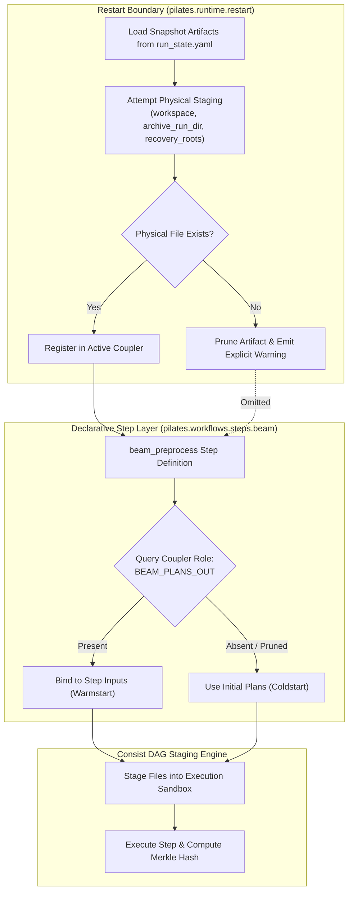

# Coupler Restart Artifact Pruning and Ephemeral Scratch Isolation Design

- **Date:** 2026-10-21
- **Status:** Proposed
- **Context:** Architectural follow-up to PR #98 (`feat/beam-plan-memory`), hotfix commit `2145ef21`, and Argon architect review on Slurm multi-node restart failures (`job27165145`).
- **Owner:** PILATES / Consist Orchestration Team

---

## 1. Executive Summary & Motivation

On HPC clusters such as Lawrencium (Slurm), jobs execute in high-speed, node-local ephemeral scratch storage (`/local/job$SLURM_JOB_ID/pilates-workspace/...`). When a job terminates—due to walltime expiration, node preemption, or an upstream error—the compute node's local scratch directory is wiped immediately by Slurm prolog/epilog scripts.

When a run is subsequently restarted using `./hpc/job_runner.sh -s <run_state.yaml>`, [`restore_restart_coupler_snapshot`](file:///Users/zaneedell/git/PILATES/pilates/runtime/restart.py) restores the previous in-memory state of the PILATES `Coupler` using serialized snapshot metadata.

During a recent SFBay smoke run restart (`job27165145`), this process exposed a critical architectural boundary flaw:

```text
FileNotFoundError: [Consist] Cannot stage input 'beam_plans_out': source path missing.
  Source: /local/job27130000/pilates-workspace/pilates-run--sfbay--consist-sfbay-smoke-sd-loop-2019--20261020-175204/beam/beam_output/.../plans.parquet
```

The Coupler snapshot contained an artifact reference pointing to `/local/job27130000/` (the previous compute node, which had already been erased). When `beam_preprocess` attempted to resolve its inputs, Consist attempted to physically stage this missing file into the new node's workspace and crashed.

The immediate hotfix in commit `2145ef21`:
1. Gated `BEAM_PLANS_OUT` resolution with `is_start_year` so initial iterations never request prior plans.
2. Injected defensive disk-existence probes (`artifact_to_existing_path`) directly inside `_resolve_beam_preprocess_inputs`, popping missing artifacts from `binding_inputs` to avoid staging crashes.
3. Expanded candidate search paths in `restore_restart_coupler_snapshot` to include `recovery_roots`.

While this safely unblocks the immediate HPC run, an architectural review concluded that:

> **Core Architectural Defect:** Workflow step wrappers (`beam.py`) should not be performing physical disk existence checks or mutating bound inputs to guard against runtime staging failures. The Coupler must maintain an invariant of **physical authenticity**: an artifact must never exist in the active Coupler if its backing file is physically absent and unrecoverable.

This document describes the target architecture to prune un-stageable artifacts at the Coupler restoration boundary, retire defensive step-level disk probes, and introduce first-class optional input tolerance in Consist.

---

## 2. Identified Anti-Patterns & Technical Debt

### 2.1 Dangling References in Restored Coupler State
When `restore_restart_coupler_snapshot` loads artifacts from `run_state.yaml`, it blindly registers them into the active `Coupler` even if staging from `archive_run_dir` or `recovery_roots` fails. This leaves the Coupler holding dangling pointers to wiped filesystem locations.

### 2.2 Leaky Abstractions into Step Wrappers
To avoid crashing when encountering a dangling Coupler pointer, `pilates/workflows/steps/beam.py` was forced to introduce physical disk validation:
```python
# Anti-pattern: Step wrapper inspecting physical filesystem to circumvent staging crashes
if BEAM_PLANS_OUT in binding_inputs:
    art = binding_inputs[BEAM_PLANS_OUT]
    if artifact_to_existing_path(art, workspace=workspace) is None:
        binding_inputs.pop(BEAM_PLANS_OUT, None)
        source_by_role[BEAM_PLANS_OUT] = "missing"
```
Step wrappers belong to the declarative pipeline definition layer. Forcing them to probe filesystem existence leaks runtime storage semantics into model choreography.

### 2.3 Cascading Fragility for Downstream Steps
Protecting only `beam_preprocess` leaves the underlying Coupler corrupt. If any other step or diagnostic tool subsequently requests `beam_plans_out` from the Coupler, it will crash with `FileNotFoundError` unless it replicates the exact same defensive disk check.

### 2.4 Silent Degradation of Convergence State
In a multi-iteration loop (e.g., if a node failure occurs at iteration 4 of 10), dropping `beam_plans_out` causes iteration 5 to fall back to initial plans. While this avoids a fatal crash, it silently discards 4 iterations of simulation warmstart progress behind a single log warning. The system must clearly distinguish between expected cold-starts (iteration 0) and compromised warmstarts (iterations > 0 with lost state).

---

## 3. Principled Target Architecture



### 3.1 The Coupler Physical Authenticity Invariant
The PILATES `Coupler` represents the shared state across steps. To guarantee pipeline safety:

> **Invariant:** Any artifact accessible via `coupler.get(role)` or present in `coupler.snapshot()` MUST have an authentic, accessible physical backing file at execution time.

If an artifact was generated in an ephemeral location and was not published to persistent storage (`recovery_roots` or `archive_run_dir`), it is ephemeral by definition. Upon node death, it ceases to exist and must be pruned from the Coupler.

### 3.2 Clean Separation of Concerns
1. **Coupler Hydrator (`restart.py`)**: Responsible for re-establishing authentic state across job boundaries. Verifies file existence; prunes missing entries; logs informative diagnostics.
2. **Step Definitions (`workflows/steps/*.py`)**: Pure business logic. Queries the Coupler for roles. If an optional role is absent (because it wasn't produced or was pruned), falls back gracefully. No disk probing.
3. **DAG Staging Engine (`consist`)**: Staging and hashing. Differentiates between required and optional inputs.

---

## 4. Detailed Component Design

### 4.1 Coupler Snapshot Pruning (`pilates/runtime/restart.py`)

In `restore_restart_coupler_snapshot`, after attempting to stage missing artifacts:

```python
def restore_restart_coupler_snapshot(
    scenario: object,
    tracker: object,
    settings: object,
    state: object,
    workspace: object,
) -> Dict[str, object]:
    """Restore coupler artifacts, pruning un-stageable node-ephemeral artifacts."""
    ...
    restored: Dict[str, object] = {}
    pruned: List[str] = []

    for key, artifact in snapshot_artifacts.items():
        # Check if the artifact file physically exists or can be staged from archive/recovery roots
        target_path = _resolve_archived_artifact_source_path(
            artifact, archive_run_dir=archive_run_dir, workspace=workspace
        )
        
        # Verify physical accessibility on disk
        if not _is_artifact_physically_available(artifact, workspace=workspace):
            # Attempt staging from archive/recovery roots
            staged = _stage_missing_restart_artifact(
                artifact=artifact,
                archive_run_dir=archive_run_dir,
                workspace=workspace,
                logger=logger,
            )
            if not staged:
                pruned.append(key)
                logger.warning(
                    "[Restart Coupler] Pruning un-stageable artifact '%s' (uri=%s). "
                    "Backing file was wiped from node scratch and cannot be recovered. "
                    "Downstream steps will execute without this state.",
                    key,
                    getattr(artifact, "container_uri", None),
                )
                continue

        # Register authentic artifact in active coupler
        scenario.coupler.set(key, artifact)
        restored[key] = artifact

    if pruned:
        logger.info(
            "[Restart Coupler] Snapshot restoration complete: %d restored, %d pruned (%s)",
            len(restored), len(pruned), ", ".join(pruned)
        )
    return restored
```

### 4.2 Retiring Step-Level Probes (`pilates/workflows/steps/beam.py`)

With Coupler pruning in place, `_resolve_beam_preprocess_inputs` is simplified back to declarative logic:

```python
# Pure declarative role resolution:
should_resolve_beam_plans_out = (current_inner_iter > 0) or (
    not is_start and not discard_plans_every_year
)

optional_roles = [
    LINKSTATS_WARMSTART,
    VEHICLE_TYPES_WARMSTART,
    CANONICAL_LINKSTATS,
]
if should_resolve_beam_plans_out:
    optional_roles.append(BEAM_PLANS_OUT)

binding_inputs, source_by_role = _resolve_optional_role_bindings(
    coupler=coupler,
    optional_roles=optional_roles,
    logical_destinations=logical_destinations,
)

# NO manual artifact_to_existing_path calls!
# NO manual binding_inputs.pop(BEAM_PLANS_OUT) calls!
```

If `BEAM_PLANS_OUT` was pruned during restart hydration, `coupler.get(BEAM_PLANS_OUT)` returns `None`. `_resolve_optional_role_bindings` marks it as unsupplied, and `beam_preprocess` cleanly falls back to initial plans without any custom disk-probing logic.

### 4.3 Consist Optional Input Staging Tolerance (`consist` library)

To protect all steps generically against unexpected file loss during DAG execution:
- Consist `StepDefinition` will support `optional=True` on input bindings.
- When `tracker.run(step)` executes staging:
  - If a bound input has `optional=True` and its physical path does not exist on disk:
    - Log a structured warning: `[Consist][staging] Optional input '{key}' omitted because source path does not exist.`
    - Remove the input from the step's runtime manifest and environment.
    - Omit the input from the Merkle DAG hash calculation.
  - If the input is required (`optional=False`), raise `FileNotFoundError` immediately.

---

## 5. Implementation Roadmap

### Phase 1: Coupler Snapshot Pruning in PILATES (Priority: High)
1. Add `_is_artifact_physically_available(artifact, workspace)` helper in `pilates/runtime/restart.py`.
2. Update `restore_restart_coupler_snapshot` to skip un-stageable artifacts and log a clear warning summary.
3. Add unit test in `tests/test_restart_hydrator.py` verifying that an un-stageable artifact is excluded from the restored coupler and does not raise an unhandled exception.

### Phase 2: Retire Defensive Disk Checks in Step Wrappers (Priority: Medium)
1. Remove `artifact_to_existing_path` probing and `binding_inputs.pop` in `pilates/workflows/steps/beam.py`.
2. Verify with `tests/test_beam_native_step_definitions.py`.

### Phase 3: Consist Optional Input Staging Tolerance (Priority: Long-Term)
1. Open Consist RFC / PR implementing `optional=True` on step input bindings.
2. Update PILATES native step declarations to leverage Consist's native optional input staging.

---

## 6. Testing & Verification Strategy

1. **Unit Test: Restart with Wiped Artifact**:
   Simulate a multi-node restart scenario in `tests/test_restart_hydrator.py`:
   - Save a snapshot containing two artifacts: one persistent in `archive_dir`, and one pointing to a non-existent `/local/job...` path with no recovery roots.
   - Run `restore_restart_coupler_snapshot`.
   - Assert: Persistent artifact is present in coupler; wiped artifact is omitted; return dict contains only valid artifacts; no exception raised.
2. **HPC Replay Verification**:
   Verify against real Lawrencium restart logs (`pilates-run--sfbay--consist-sfbay-smoke-sd-loop-2019--20261020-175204`) confirming that iteration 0 completes cleanly without manual intervention.
