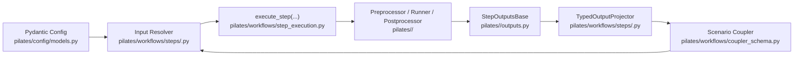

# Adding a Model

Integrating a simulator into PILATES connects an external runtime to the workflow planner, the typed artifact coupler, and Consist provenance tracking.

## Architecture of a Model Integration

Every model integration spans four layers in the repository:

| Layer | Path | Responsibility |
| --- | --- | --- |
| Adapter and outputs | `pilates/<model>/{preprocessor,runner,postprocessor,outputs}.py` | Translates canonical coupler artifacts into simulator inputs, invokes the container or local process, and packages raw outputs into a `StepOutputsBase` subclass. |
| Step definition and contracts | `pilates/workflows/steps/<model>.py` | Declares `@define_step` callables, `StepDefinition` metadata, `InputContract` specifications, `ResolvedStepInputs` resolvers, and `TypedOutputProjector` mappings. |
| Stage orchestration and planning | `pilates/workflows/stages/<stage>.py`, `pilates/workflows/planning.py` | Calls `execute_step(...)` inside a stage (`initialize`, `land_use`, `demand`, `supply`, or `postprocess`) and registers the model on the static execution plan. |
| Config and coupler schema | `pilates/config/models.py`, `pilates/workflows/artifact_keys.py`, `pilates/workflows/coupler_schema.py` | Validates `config.yaml` settings with Pydantic and registers semantic artifact keys on `PILATESCouplerSchema`. |



## Scaffolding a Model Skeleton

Run `scripts/new_model_scaffold.py` to generate boilerplate files and a customized integration checklist. Preview the file list with `--dry-run` before writing to disk:

```bash
python scripts/new_model_scaffold.py my_model --major-stage demand --dry-run
python scripts/new_model_scaffold.py my_model --major-stage demand
```

The scaffold script writes or updates the following paths:

- `pilates/my_model/__init__.py`
- `pilates/my_model/preprocessor.py`
- `pilates/my_model/runner.py`
- `pilates/my_model/postprocessor.py`
- `pilates/my_model/outputs.py`
- `pilates/workflows/steps/my_model.py`
- `pilates/workflows/steps/__init__.py`
- `pilates/workflows/catalog.py`
- `docs/checklists/add_model_my_model.md`

After scaffolding, register your config block in `pilates/config/models.py` and wire the stage call into `pilates/workflows/stages/<stage>.py` and `pilates/workflows/planning.py`.

## Implementing Step Contracts

`pilates/workflows/step_execution.py` runs every workflow step through `execute_step(...)`. The executor resolves inputs once, calls `scenario.run(...)`, archives outputs to `run.output_directory`, updates `scenario.coupler`, and projects typed results.

### 1. Define Semantic Artifact Keys

Add your model's input and output keys to `pilates/workflows/artifact_keys.py` and register their descriptions and validation schemas in `pilates/workflows/coupler_schema.py`. See [Artifact Flow](../workflow/artifact_flow.md) for key naming conventions.

### 2. Declare `StepOutputs`

Subclass `StepOutputsBase` (aliased as `StepOutputs` in `pilates/workflows/outputs_base.py`) inside `pilates/<model>/outputs.py`. Override the properties that tell `execute_step(...)` which coupler keys to publish and verify:

```python
from pathlib import Path
from typing import Mapping
from pilates.workflows.artifact_keys import MY_MODEL_PRIMARY_OUTPUT
from pilates.workflows.outputs_base import ArtifactValue, StepOutputs


class MyModelOutputs(StepOutputs):
    output_table: Path | None = None

    @property
    def outputs(self) -> Mapping[str, ArtifactValue]:
        if self.output_table is None:
            return {}
        return {MY_MODEL_PRIMARY_OUTPUT: self.output_table}

    @property
    def required_outputs(self) -> tuple[str, ...]:
        return (MY_MODEL_PRIMARY_OUTPUT,)
```

### 3. Build the Input Resolver and `InputContract`

In `pilates/workflows/steps/<model>.py`, resolve upstream artifacts and configuration once using `build_resolved_binding(...)` from `pilates/workflows/binding.py`. Pair each step with an `InputContract`:

- Set `ConfigContract.adapter(get_my_model_adapter)` when the step hashes a Consist `ConfigAdapter` directory, or `ConfigContract.payload()` when `resolve_inputs` returns a `config_payload` dictionary.
- Set `status="complete"` once `resolve_inputs` supplies all artifact bindings and config identity fields required for cache hits and hydration. Keep `status="incomplete"` with a clear `reason` string while any runtime lookup bypasses `ResolvedStepInputs`.

```python
from pilates.workflows.binding import ArtifactBindingRule, build_resolved_binding
from pilates.workflows.step_definition import (
    ConfigContract,
    InputContract,
    StepDefinition,
    TypedOutputProjector,
    define_step,
)

MY_MODEL_INPUT_RULES = (
    ArtifactBindingRule(
        input_key="households",
        coupler_key="urbansim_households",
        required=True,
    ),
)


def resolve_my_model_inputs(*, context):
    return build_resolved_binding(
        context=context,
        rules=MY_MODEL_INPUT_RULES,
        config_payload={"sample_rate": context.config.my_model.sample_rate},
    )
```

### 4. Wire `StepDefinition` and `execute_step`

Bind the step function, `InputContract`, `resolve_inputs` callback, and `TypedOutputProjector` into a `StepDefinition`. Inside `pilates/workflows/stages/<stage>.py`, invoke `execute_step(context=context, definition=MY_MODEL_STEP_DEFINITION, ...)` so the runtime enforces input resolution, Consist caching, output validation, and archive promotion through a single code path. See [Architecture](../workflow/architecture.md) and [Step Contracts](../workflow/step_contracts.md) for details on step execution.

## Testing Progression

Validate a new integration across four test tiers using `/Users/zaneedell/miniforge3/envs/PILATES/bin/python -m pytest`:

### 1. Step Definition and Contract Unit Tests

Verify catalog registration, `StepOutputs` key declarations, and `InputContract` metadata without launching containers:

```bash
pytest tests/test_step_definitions.py tests/test_stage_contracts.py -v
```

### 2. Stage Orchestration and Binding Tests

Confirm that `resolve_inputs` binds upstream coupler keys, rejects missing required inputs, and projects typed outputs back onto the coupler:

```bash
pytest tests/test_step_execution.py tests/test_step_execution_architecture.py -v
```

### 3. Stubbed Workflow and Guardrail Tests

Add a lightweight stub mode for your step and exercise multi-stage orchestration and architectural invariants:

```bash
pytest tests/test_golden_stub_workflow.py tests/test_architecture_guardrails.py -v
```

### 4. Preserving Generated Test Artifacts for Inspection

Fixtures clean up temporary directories when pytest exits. Set `PRESERVE_TEST_OUTPUT` to copy generated workspaces, HDF5 stores, skims, and DuckDB databases into `./test_output/<timestamp>_<test_name>/` after a test completes:

```bash
# Copy outputs to ./test_output/
PRESERVE_TEST_OUTPUT=1 pytest tests/test_golden_stub_workflow.py -v

# Copy outputs to a custom directory
PRESERVE_TEST_OUTPUT=/tmp/my_model_debug pytest tests/test_golden_stub_workflow.py -v
```

Setting `PRESERVE_TEST_OUTPUT` on a test that uses the `preserve_test_output` fixture (in `tests/conftest.py`) causes pytest to print the destination path at teardown so you can inspect intermediate files and `.consist/provenance.duckdb` records.
