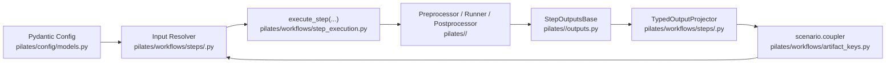

# Adding a Model

Integrating a simulator into PILATES connects an external runtime to the workflow planner, the [typed artifact coupler (`scenario.coupler`)](../workflow/artifact_flow.md#what-scenariocoupler-is-and-what-we-rely-on-it-to-do), and Consist provenance tracking.

## Architecture of a Model Integration

Every model integration spans four layers in the repository:

| Layer | Path | Responsibility |
| --- | --- | --- |
| Adapter and outputs | `pilates/<model>/{preprocessor,runner,postprocessor,outputs}.py` | Translates canonical coupler artifacts into simulator inputs, invokes the container or local process, and packages raw outputs into a `StepOutputsBase` subclass. |
| Step definition and contracts | `pilates/workflows/steps/<model>.py` | Declares `@define_step` callables, `StepDefinition` metadata, `InputContract` specifications, `ArtifactBindingRule` fallback policies, `ResolvedStepInputs` resolvers, and `TypedOutputProjector` mappings. |
| Stage orchestration and catalog | `pilates/workflows/stages/<stage>.py`, `pilates/workflows/catalog.py` | Calls `execute_step(...)` inside a stage (`land_use`, `vehicle_ownership_model`, `supply_demand_loop`, or `postprocessing`) and registers `WorkflowStepSpec` entries on the static catalog. |
| Config, keys, and facets | `pilates/config/models.py`, `pilates/workflows/artifact_keys.py`, `pilates/utils/consist_config.py` | Validates `config.yaml` settings with Pydantic, registers canonical coupler keys, and builds Consist identity and facet payloads. |



## Scaffolding a Model Skeleton

Run `scripts/new_model_scaffold.py` to generate boilerplate files and a customized integration checklist. Preview the file list with `--dry-run` before writing to disk:

```bash
python scripts/new_model_scaffold.py my_model --major-stage supply_demand_loop --dry-run
python scripts/new_model_scaffold.py my_model --major-stage supply_demand_loop
```

The scaffold script writes or updates the following paths:

- `pilates/my_model/__init__.py`
- `pilates/my_model/preprocessor.py`
- `pilates/my_model/runner.py`
- `pilates/my_model/postprocessor.py`
- `pilates/my_model/outputs.py`
- `pilates/workflows/steps/my_model.py`
- `pilates/workflows/steps/__init__.py`
- `pilates/workflows/catalog.py`
- `docs/checklists/add_model_my_model.md`

After scaffolding, register your config block in `pilates/config/models.py` and wire the stage call into `pilates/workflows/stages/<stage>.py`.

## Implementing Step Contracts

`pilates/workflows/step_execution.py` runs every workflow step through `execute_step(...)`. The executor resolves inputs once, calls `scenario.run(...)`, archives outputs, publishes updated keys to `scenario.coupler`, and projects typed results. For a side-by-side walkthrough of a complete step implementation, see [Anatomy of a Real Step (`beam_preprocess`)](../workflow/step_contracts.md#anatomy-of-a-real-step-beam_preprocess).

### 1. Define Semantic Artifact Keys

Add your model's input and output keys to `pilates/workflows/artifact_keys.py` (`ARTIFACT_KEYS` and `ArtifactKeys`) so they can be published and resolved through `scenario.coupler`:

- See [What `scenario.coupler` Is and What We Rely On It To Do](../workflow/artifact_flow.md#what-scenariocoupler-is-and-what-we-rely-on-it-to-do) and [The Four-Step Artifact Lifecycle](../workflow/artifact_flow.md#the-four-step-artifact-lifecycle) for how coupler keys decouple upstream producers from downstream consumers across years and iterations.
- See [Canonical Coupler Keys by Domain](../workflow/artifact_flow.md#canonical-coupler-keys-by-domain) for existing key naming conventions (`usim_*`, `atlas_*`, `*_asim_*`, `*_beam_*`, and `*skims*`).

### 2. Declare `StepOutputsBase`

Subclass `StepOutputsBase` (`pilates/workflows/outputs_base.py`) inside `pilates/<model>/outputs.py`. Declare the canonical output keys to publish to `scenario.coupler` and the workspace path fields that `StepOutputsBase.validate()` checks after execution or cache hydration:

```python
from dataclasses import dataclass, field
from pathlib import Path
from typing import ClassVar, Dict, Tuple

from pilates.workflows.outputs_base import StepOutputsBase


@dataclass
class MyModelRunOutputs(StepOutputsBase):
    primary_output_attr: ClassVar[str] = "output_root"
    declared_outputs: ClassVar[Tuple[str, ...]] = (  # (1)!
        "my_model_primary_output",
        "my_model_optional_summary",
    )
    required_outputs: ClassVar[Tuple[str, ...]] = (  # (2)!
        "my_model_primary_output",
    )
    required_path_fields: ClassVar[Tuple[str, ...]] = ("output_root",)
    dict_path_fields: ClassVar[Tuple[str, ...]] = ("raw_outputs",)

    output_root: Path
    raw_outputs: Dict[str, Path] = field(default_factory=dict)
```

1. All canonical keys that `execute_step(...)` archives and publishes to `scenario.coupler` when present.
2. Keys that must exist on every completed run (`my_model_optional_summary` may be omitted when optional features are disabled).

### 3. Build the Input Resolver, `ArtifactBindingRule`, and `InputContract`

In `pilates/workflows/steps/<model>.py`, declare how your step binds upstream artifacts from `scenario.coupler` and pair each step with an `InputContract`:

- Attach `ArtifactBindingRule` entries to `StepDefinition.binding_rules` so the step can adapt when optional upstream stages (like UrbanSim or ATLAS) are enabled or disabled. See [How Input Binding Adapts to Active Models](../workflow/step_contracts.md#how-input-binding-adapts-to-active-models) for concrete multi-candidate binding patterns.
- Set `ConfigContract.adapter("my_model")` when the step hashes a Consist `ConfigAdapter` directory, or `ConfigContract.payload()` when the step hashes config parameters directly.
- Start with `status="incomplete"` and a clear `reason` string while scaffolding; promote to `status="complete"` once `resolve_inputs` supplies all artifact bindings and config identity fields required for cache hits and hydration.

```python
from pilates.workflows.binding import ArtifactBindingRule
from pilates.workflows.step_definition import (
    ConfigContract,
    InputContract,
    StepDefinition,
)

_MY_MODEL_RUN_INPUT_CONTRACT = InputContract(
    status="complete",
    config_contract=ConfigContract.adapter("my_model"),
)

MY_MODEL_BINDING_RULES = (
    ArtifactBindingRule(
        semantic_key="households_in",
        required=True,
        preferred_keys=(  # (1)!
            "households_asim_out",
            "usim_population_households_table",
        ),
    ),
)
```

1. Checks `scenario.coupler` from left to right: binds ActivitySim's output households when ActivitySim is enabled, or falls back to UrbanSim's extracted households table.

### 4. Wire `StepDefinition`, `execute_step`, and Provenance Facets

Bind the `@define_step` function, `InputContract`, `resolve_inputs` callback, `project_outputs` projector, and `binding_rules` into a `StepDefinition` (see [Core Contract Types Reference](../workflow/step_contracts.md#core-contract-types-reference) for every field on `StepDefinition`, `ArtifactBindingRule`, `ResolvedStepInputs`, and `WorkflowStepSpec`).

- **Stage execution**: Inside `pilates/workflows/stages/<stage>.py`, invoke `execute_step(...)` so the runtime enforces input resolution, Consist caching, archive promotion, and coupler publication through a single code path. See [Runtime Execution: Fresh Run vs. Cache Hit](../workflow/step_contracts.md#runtime-execution-fresh-run-vs-cache-hit) for how `execute_step(...)` handles both fresh runs and cached hydrations.
- **Provenance facets**: Register your model's config and facet builder in `pilates/utils/consist_config.py` and reference its `builder_key` in `pilates/workflows/catalog.py` (`WorkflowStepProvenanceSpec`) so run parameters are indexed in `provenance.duckdb`. See [Queryable Facets in DuckDB](../workflow/artifact_flow.md#queryable-facets-in-duckdb) for how run and artifact facets are structured and queried.

## Testing Progression

Validate a new integration across four test tiers using `/Users/zaneedell/miniforge3/envs/PILATES/bin/python -m pytest`:

### 1. Step Definition and Contract Unit Tests

Verify catalog registration, `StepOutputsBase` key declarations, and `InputContract` metadata without launching containers:

```bash
pytest tests/test_step_definitions.py tests/test_stage_contracts.py -v
```

### 2. Stage Orchestration and Binding Tests

Confirm that `resolve_inputs` binds upstream coupler keys, rejects missing required inputs, and projects typed outputs back onto `scenario.coupler`:

```bash
pytest tests/test_step_execution.py tests/test_step_execution_architecture.py -v
```

### 3. Stubbed Workflow and Guardrail Tests

Add a lightweight stub mode for your step and exercise multi-stage orchestration and architectural invariants:

```bash
pytest tests/test_golden_stub_workflow.py tests/test_architecture_guardrails.py -v
```

### 4. Preserving Generated Test Artifacts for Inspection

Fixtures clean up temporary directories when pytest exits. Set `PRESERVE_TEST_OUTPUT` to copy generated workspaces, HDF5 stores, skims, and DuckDB databases into `./test_output/<timestamp>_<test_name>/` after a test completes:

```bash
# Copy outputs to ./test_output/
PRESERVE_TEST_OUTPUT=1 pytest tests/test_golden_stub_workflow.py -v

# Copy outputs to a custom directory
PRESERVE_TEST_OUTPUT=/tmp/my_model_debug pytest tests/test_golden_stub_workflow.py -v
```

Setting `PRESERVE_TEST_OUTPUT` on a test that uses the `preserve_test_output` fixture (in `tests/conftest.py`) causes pytest to print the destination path at teardown so you can inspect intermediate files and `provenance/provenance.duckdb` records.
