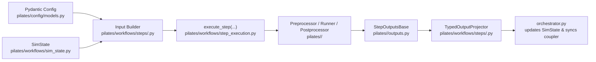

# Adding a Model

Integrating a simulator into PILATES connects an external runtime to the typed `SimState` orchestrator (`pilates/workflows/orchestrator.py`) and Consist provenance tracking.

## Architecture of a Model Integration

Every model integration spans four layers in the repository:

| Layer | Path | Responsibility |
| --- | --- | --- |
| Adapter and outputs | `pilates/<model>/{preprocessor,runner,postprocessor,outputs}.py` | Translates typed `SimState` artifacts into simulator inputs, idempotently prepares mutable model workspace configs/static inputs, invokes the container or local process, and packages raw outputs into a `StepOutputsBase` subclass. |
| Step definition and contracts | `pilates/workflows/steps/<model>.py` | Declares `@define_step` callables, `StepDefinition` metadata, `InputContract` specifications, `StepCallInputs` builders from `SimState`, and `TypedOutputProjector` mappings. |
| Orchestration and catalog | `pilates/workflows/orchestrator.py`, `pilates/workflows/catalog.py` | Calls `execute_step(...)` inside `run_pilates()` (`land_use`, `vehicle_ownership_model`, `supply_demand_loop`, or `postprocessing`), updates `SimState`, syncs `scenario.coupler`, and registers `WorkflowStepSpec` entries on the static catalog. |
| Config, state, and facets | `pilates/config/models.py`, `pilates/workflows/sim_state.py`, `pilates/workflows/consist_metadata.py` | Validates `config.yaml` settings with Pydantic, defines typed `SimState` slots (or `extras`), and builds Consist identity and facet payloads. |



## Scaffolding a Model Skeleton

Run `scripts/new_model_scaffold.py` to generate boilerplate files and a customized integration checklist. Preview the file list with `--dry-run` before writing to disk:

```bash
python scripts/new_model_scaffold.py my_model --major-stage supply_demand_loop --dry-run
python scripts/new_model_scaffold.py my_model --major-stage supply_demand_loop
```

The scaffold script writes or updates the following paths:

- `pilates/my_model/__init__.py`
- `pilates/my_model/preprocessor.py`
- `pilates/my_model/runner.py`
- `pilates/my_model/postprocessor.py`
- `pilates/my_model/outputs.py`
- `pilates/workflows/steps/my_model.py`
- `pilates/workflows/steps/__init__.py`
- `pilates/workflows/catalog.py`
- `docs/checklists/add_model_my_model.md`

After scaffolding, register your config block in `pilates/config/models.py` and wire the step/stage call into `pilates/workflows/orchestrator.py` (for example, before or after `run_traffic_assignment_phase` inside `_run_supply_demand_loop`).

## Implementing Step Contracts

`pilates/workflows/step_execution.py` runs every workflow step through `execute_step(...)`. The executor resolves `StepCallInputs` from `SimState`, calls `scenario.run(...)`, archives outputs, and projects typed results. `orchestrator.py` then updates `SimState` and syncs `scenario.coupler.update(sim_state.to_role_map())` at stage boundaries.

### 1. Add Typed Fields to `SimState` (or Use `SimState.extras`)

Add typed `ArtifactRef | None` fields to `pilates/workflows/sim_state.py` (or store model-specific artifacts in `SimState.extras`) so upstream outputs flow explicitly into downstream steps:

- See [Canonical Coupler Keys by Domain](../workflow/artifact_flow.md#canonical-coupler-keys-by-domain) for existing key naming conventions (`usim_*`, `atlas_*`, `*_asim_*`, `*_beam_*`, and `*skims*`).

### 2. Declare `StepOutputsBase`

Subclass `StepOutputsBase` (`pilates/workflows/outputs_base.py`) inside `pilates/<model>/outputs.py`. Declare the path fields that `StepOutputsBase.validate()` checks after execution or cache hydration:

```python
from dataclasses import dataclass, field
from pathlib import Path
from typing import ClassVar, Dict, Tuple

from pilates.workflows.outputs_base import StepOutputsBase


@dataclass
class MyModelRunOutputs(StepOutputsBase):
    required_path_fields: ClassVar[Tuple[str, ...]] = ("output_root",)  # (1)!
    dict_path_fields: ClassVar[Tuple[str, ...]] = ("raw_outputs",)  # (2)!

    output_root: Path
    raw_outputs: Dict[str, Path] = field(default_factory=dict)
```

1. Path attributes that `StepOutputsBase.validate()` requires to exist on disk after execution or hydration.
2. Dictionary attributes whose `Path` values are checked for existence on disk. Optional single-path attributes go in `optional_path_fields`, and semantic checks go in `validators` (`OutputValidator` instances).

### 3. Build the `SimState` Input Resolver and `InputContract`

In `pilates/workflows/steps/<model>.py`, build `StepCallInputs` directly from `SimState` and pair each step with an `InputContract`:

- Select upstream inputs directly from `sim_state` (for example `sim_state.demand.households or sim_state.demand.households_in`) using plain Python conditionals—no `ArtifactBindingRule` is needed; register new coupler keys in `pilates/workflows/artifact_keys.py` and `SimState.to_role_map()` (plus `pilates/workflows/coupler_schema.py` if adding a typed coupler schema field).
- Set `ConfigContract.adapter("my_model")` when the step hashes a Consist `ConfigAdapter` directory, or `ConfigContract.payload()` when the step hashes config parameters.
- Start with `status="incomplete"` and a clear `reason` string while scaffolding; promote to `status="complete"` once `resolve_inputs` supplies all artifact bindings and config identity fields required for cache hits and hydration.

```python
from pathlib import Path

from pilates.workflows.contracts import (
    ConfigContract,
    InputContract,
    StepCallInputs,
    StepDefinition,
)
from pilates.workflows.sim_state import SimState

_MY_MODEL_RUN_INPUT_CONTRACT = InputContract(
    status="complete",
    config_contract=ConfigContract.adapter("my_model"),
)


def _resolve_my_model_inputs(
    *, workspace: object, sim_state: SimState | None = None, **_: object
) -> StepCallInputs:
    active = sim_state if sim_state is not None else SimState()
    households = active.demand.households or active.land_use.current_h5
    return StepCallInputs(
        inputs={"households_in": households} if households is not None else {},
        logical_destinations={
            "households_in": Path(workspace.full_path) / "my_model" / "households.csv"
        },
        required_keys=("households_in",),
    )
```

### 4. Wire `StepDefinition`, `execute_step`, and `orchestrator.py`

Bind the `@define_step` function, `InputContract`, `resolve_inputs` callback, and `project_outputs` projector into a `StepDefinition`.

- **Orchestrator execution**: Inside `pilates/workflows/orchestrator.py` (for example before/after BEAM in `_run_supply_demand_loop`), invoke `execute_step(..., sim_state=sim_state)` and return the updated `SimState`.
- **Provenance facets**: Register your model's config and facet builder in `pilates/workflows/consist_metadata.py` and reference its `builder_key` in `pilates/workflows/catalog.py` (`WorkflowStepProvenanceSpec`) so run parameters are indexed in `provenance.duckdb`. See [Queryable Facets in DuckDB](../workflow/artifact_flow.md#queryable-facets-in-duckdb) for how run and artifact facets are structured and queried.

## Testing Progression

Validate a new integration across five test tiers using `/Users/zaneedell/miniforge3/envs/PILATES/bin/python -m pytest`:

### 1. Step Definition and Contract Unit Tests

Verify catalog registration, `StepOutputsBase` key declarations, and `InputContract` metadata without launching containers:

```bash
pytest tests/test_step_definitions.py tests/test_stage_contracts.py -v
```

### 2. Stage Orchestration and Binding Tests

Confirm that `resolve_inputs` binds upstream coupler keys, rejects missing required inputs, and projects typed outputs back onto `scenario.coupler`:

```bash
pytest tests/test_step_execution.py tests/test_step_execution_architecture.py -v
```

### 3. Stubbed Workflow and Guardrail Tests

Add a lightweight stub mode for your step and exercise multi-stage orchestration and architectural invariants:

```bash
pytest tests/test_golden_stub_workflow.py tests/test_architecture_guardrails.py -v
```

### 4. Contract-Validating Workflow Harness

Run the deterministic contract-validating workflow harness (`tests/test_contract_validating_workflow_harness.py` backed by `tests/helpers/contract_container_backend.py`), which executes real preprocessors, postprocessors, output validators, and Consist caching against fast in-process container simulators across multi-year runs, cold-scratch cache hydration, mid-run restarts, and schema-corruption fault injection:

```bash
pytest tests/test_contract_validating_workflow_harness.py -v
```

### 5. Preserving Generated Test Artifacts for Inspection

Fixtures clean up temporary directories when pytest exits. Set `PRESERVE_TEST_OUTPUT` to copy generated workspaces, HDF5 stores, skims, and DuckDB databases into `./test_output/<timestamp>_<test_name>/` after a test completes:

```bash
# Copy outputs to ./test_output/
PRESERVE_TEST_OUTPUT=1 pytest tests/test_golden_stub_workflow.py -v

# Copy outputs to a custom directory
PRESERVE_TEST_OUTPUT=/tmp/my_model_debug pytest tests/test_golden_stub_workflow.py -v
```

Setting `PRESERVE_TEST_OUTPUT` on a test that uses the `preserve_test_output` fixture (in `tests/conftest.py`) prints the destination path at teardown so you can inspect intermediate files and `.consist/provenance.duckdb` records.
