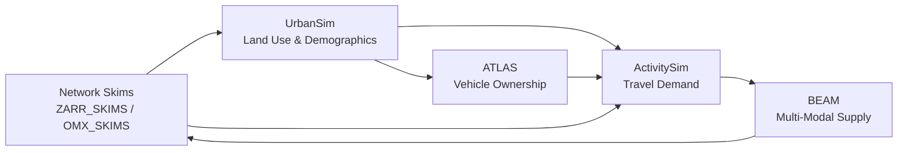

# Model Boundaries and Stack Reference

PILATES couples four domain simulators across forecast years and replanning iterations. Each simulator runs inside its own step boundary, reads declared upstream inputs through `ResolvedStepInputs`, and publishes canonical outputs onto the [Artifact Coupler](../workflow/artifact_flow.md).

## Model Stack Overview

| Model | Domain Role | Workflow Stage | Primary Inputs | Primary Outputs |
| --- | --- | --- | --- | --- |
| **UrbanSim** | Land use and demographic forecasting | `land_use` | Base/prior-year HDF5 model store (`usim_datastore_h5`), accessibility skims (`final_skims_omx` / `omx_skims`) | Forecasted households, persons, jobs, buildings, blocks, and land-use tables (`usim_forecast_output`, `usim_population_source_h5`) |
| **ATLAS** | Household vehicle fleet synthesis | `vehicle_ownership_model` | UrbanSim demographic tables (`usim_datastore_h5`, `usim_datastore_base_h5`) | Updated HDF5 vehicle counts (`usim_h5_updated`, `usim_population_source_h5`) and fleet table (`atlas_vehicles2_output`) |
| **ActivitySim** | Activity-based travel demand | `supply_demand_loop` (`activity_demand`) | Land use, households, persons (`land_use_asim_in`, `households_asim_in`, `persons_asim_in`), and network skims (`zarr_skims` or `omx_skims`) | Disaggregate `households_asim_out`, `persons_asim_out`, `tours_asim_out`, `trips_asim_out`, `beam_plans_asim_out` |
| **BEAM** | Multi-modal agent-based network supply | `supply_demand_loop` (`traffic_assignment`) | ActivitySim plans (`plans_beam_in`, `households_beam_in`, `persons_beam_in`), optional ATLAS vehicles (`vehicles_beam_in`), road and transit networks | Origin-destination skims (`final_skims_omx`, `zarr_skims`, `omx_skims`), `linkstats`, `beam_plans_out`, `beam_experienced_plans_xml` |

---

## UrbanSim Boundary

### Code Entry Points

- Step definition: `pilates/workflows/steps/urbansim.py` (`urbansim_run`, `urbansim_postprocess`)
- Adapter modules: `pilates/urbansim/{preprocessor,runner,postprocessor,outputs}.py`
- Stage caller: `pilates/workflows/stages/land_use.py`

### Upstream Inputs and Coupler Keys

| Input | Coupler Key / Source | Format |
| --- | --- | --- |
| Base-year or prior-year model store | `usim_datastore_h5` / `usim_datastore_base_h5` (`custom_mpo_<region>_model_data.h5`) | HDF5 |
| Travel time and cost skims | `final_skims_omx` or `omx_skims` | OMX |
| Static UrbanSim inputs | Staged idempotently by `stage_urbansim_run_workspace` and tracked via `selected_urbansim_static_input_sources` | CSV / YAML |

### Container Mounts and Working Directories

- Host data directory mounts into `/data` inside the UrbanSim container.
- `stage_urbansim_run_workspace` and `urbansim_run` materialize the current HDF5 datastore, travel skims (`final_skims.omx`), and static input files into the UrbanSim mutable data directory before container startup.

### Published Outputs

- Year-tagged demographic and land-use tables (`households`, `persons`, `jobs`, `buildings`, `blocks`) stored in the output HDF5 store and extracted for downstream consumers.
- Coupler keys: `usim_datastore_h5`, `usim_forecast_output`, `usim_population_source_h5`, `usim_input_merged_{year}`, `usim_input_archive_{year}`, while `run_land_use_stage` preserves `usim_datastore_base_h5` and `usim_population_source_h5`.

---

## ATLAS Boundary

### Code Entry Points

- Step definition: `pilates/workflows/steps/atlas.py` (`atlas_preprocess`, `atlas_run`, `atlas_postprocess`)
- Adapter modules: `pilates/atlas/{preprocessor,runner,postprocessor,outputs}.py`
- Stage caller: `pilates/workflows/stages/vehicle_ownership.py`

### Upstream Inputs and Coupler Keys

| Input | Coupler Key / Source | Format |
| --- | --- | --- |
| Forecasted households, persons, blocks, residential, jobs | `usim_datastore_h5` and `usim_datastore_base_h5` | HDF5 / CSV |
| Travel skims (optional) | `final_skims_omx` / `omx_skims` | OMX |
| Static ATLAS inputs | Staged idempotently by `stage_selected_atlas_static_inputs` and tracked via `selected_atlas_static_input_sources` | CSV / RData |

### Container Mounts and Working Directories

- Host input directory (`pilates/atlas/atlas_input/year<year>/`) and output directory (`pilates/atlas/atlas_output/`) mount into the ATLAS container.
- Execution runs for each scheduled sub-year when `atlas` is configured and enabled (`state.atlas_enabled`).

### Published Outputs

- `householdv_{year}`, `vehicles_{year}`, `usim_h5_updated`, `usim_population_source_h5` (HDF5 datastore with updated `cars` and `vehicl` columns), and `atlas_vehicles2_output` (`vehicles_{year}.csv` with body type, vintage, and powertrain attributes).

---

## ActivitySim Boundary

### Code Entry Points

- Step definition: `pilates/workflows/steps/activitysim.py` (`activitysim_preprocess`, `activitysim_run`, `activitysim_postprocess`)
- Adapter modules: `pilates/activitysim/{preprocessor,runner,postprocessor,outputs}.py`
- Stage caller: `pilates/workflows/stages/supply_demand_activity.py`

### Upstream Inputs and Coupler Keys

| Input | Coupler Key / Source | Format |
| --- | --- | --- |
| Land use and demographics | `usim_population_source_h5` (or fallback `usim_h5_updated` / `usim_datastore_h5`) | HDF5 / CSV |
| Preprocessed ActivitySim CSVs | `land_use_asim_in`, `households_asim_in`, `persons_asim_in` | CSV |
| Network skims | `zarr_skims` (preferred when cached) or `omx_skims` / `final_skims_omx` | Zarr or OMX |
| Model configuration | Mutable ActivitySim config directory prepared idempotently by `ensure_activitysim_mutable_configs` | YAML / CSV |

### Container Mounts and Working Directories

- ActivitySim mounts three directories: `configs` (`/configs`), `data` (`/data`), and `output` (`/output`).
- `activitysim_preprocess` builds `households.csv`, `persons.csv`, `land_use.csv`, and aligned 0-based skims (`skims.omx`) in `/data` before launching ActivitySim. See [Zone and Skim Alignment](zone_and_skim_alignment.md) for zone indexing details.

### Published Outputs

- Coupler keys: `households_asim_out`, `persons_asim_out`, `tours_asim_out`, `trips_asim_out`, `beam_plans_asim_out`, `zarr_skims`, and `usim_input_merged_{year}`.
- Optional DuckDB ingestion tables registered in `pilates/database/schema/registry.py`. See [Database and Schemas](database_and_schemas.md).

---

## BEAM Boundary

### Code Entry Points

- Step definition: `pilates/workflows/steps/beam.py` (`beam_preprocess`, `beam_run`, `beam_postprocess`, `beam_full_skim`)
- Adapter modules: `pilates/beam/{preprocessor,runner,postprocessor,outputs}.py`
- Stage caller: `pilates/workflows/stages/supply_demand_beam.py`

### Upstream Inputs and Coupler Keys

| Input | Coupler Key / Source | Format |
| --- | --- | --- |
| Disaggregate demand plans | `beam_plans_asim_out` / `plans_beam_in`, `households_asim_out` / `households_beam_in`, `persons_asim_out` / `persons_beam_in` | CSV / CSV.GZ |
| Vehicle fleet (optional) | `atlas_vehicles2_output` -> `vehicles_beam_in` | CSV |
| Prior iteration linkstats / plans | `linkstats_warmstart`, `beam_output_plans_xml`, `beam_output_experienced_plans_xml` | CSV.GZ / XML.GZ |
| Scenario configuration and network | Mutable BEAM workspace prepared idempotently by `ensure_beam_mutable_workspace` (`.conf`, network XML, transit feeds) | HOCON / XML / ZIP |

### Container Mounts and Working Directories

- BEAM mounts the regional scenario folder and writes simulation outputs under `beam_output/<region>/year-<year>-iteration-<iteration>/`.
- `beam_postprocess` converts raw BEAM origin-destination skim CSVs (`*.csv.gz`) into consolidated OMX (`final_skims_omx`, `omx_skims`) and Zarr (`zarr_skims`) matrices for the next replanning iteration or forecast year.

### Published Outputs

- Coupler keys: `final_skims_omx`, `omx_skims`, `zarr_skims`, `linkstats`, `linkstats_warmstart`, `beam_network_final`, `beam_plans_out`, `beam_output_plans_xml`, `beam_experienced_plans_xml`, and `beam_output_experienced_plans_xml`.
