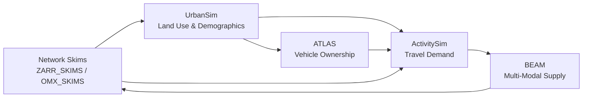

# Model Boundaries and Stack Reference

PILATES couples four domain simulators across forecast years and replanning iterations. Each simulator runs inside its own step boundary, reads declared upstream inputs through `ResolvedStepInputs`, and publishes canonical outputs onto the [Artifact Coupler](../workflow/artifact_flow.md).

## Model Stack Overview

| Model | Domain Role | Workflow Stage | Primary Inputs | Primary Outputs |
| --- | --- | --- | --- | --- |
| **UrbanSim** | Land use and demographic forecasting | `land_use` | Base/prior-year HDF5 model store, accessibility skims (`ZARR_SKIMS` or `OMX_SKIMS`) | Forecasted households, persons, jobs, buildings, blocks, and land-use tables |
| **ATLAS** | Household vehicle fleet synthesis | `land_use` (vehicle ownership step) | UrbanSim demographic tables (`households`, `persons`, `blocks`) | Synthesized household vehicle counts and fleet attributes (`vehicles.csv`, `households.csv`) |
| **ActivitySim** | Activity-based travel demand | `demand` | Land use, households, persons, tours/vehicles, and network skims | Disaggregate `final_households`, `final_persons`, `final_tours`, `final_trips`, `final_land_use` |
| **BEAM** | Multi-modal agent-based network supply | `supply` | ActivitySim plans (`persons`, `households`, `plans`/`tours`/`trips`), road and transit networks | Origin-destination skims (`FINAL_SKIMS_OMX`, `ZARR_SKIMS`), `BEAM_LINKSTATS`, `BEAM_EVENTS` |

---

## UrbanSim Boundary

### Code Entry Points

- Step definition: `pilates/workflows/steps/urbansim.py`
- Adapter modules: `pilates/urbansim/{preprocessor,runner,postprocessor,outputs}.py`
- Stage caller: `pilates/workflows/stages/land_use.py`

### Upstream Inputs and Coupler Keys

| Input | Coupler Key / Source | Format |
| --- | --- | --- |
| Base-year or prior-year model store | `URBANSIM_INPUT_STORE` (`custom_mpo_<region>_model_data.h5`) | HDF5 |
| Travel time and cost skims | `ZARR_SKIMS` (preferred) or `OMX_SKIMS` / `FINAL_SKIMS_OMX` | Zarr or OMX |
| Canonical zone mapping | `pilates/utils/zone_utils.py` | CSV / Parquet |

### Container Mounts and Working Directories

- Host data directory mounts into `/data` inside the UrbanSim container.
- The preprocessor writes the travel model skim table (`travel_data.csv` or HDF5 travel data node) and base-year store into the step working directory before container startup.

### Published Outputs

- Year-tagged demographic and land-use tables (`households`, `persons`, `jobs`, `buildings`, `blocks`, `zones`) stored in the output HDF5 store and extracted to CSV/Parquet for downstream consumers.
- Coupler keys: `URBANSIM_OUTPUT_STORE`, `URBANSIM_HOUSEHOLDS`, `URBANSIM_PERSONS`, `URBANSIM_JOBS`, `URBANSIM_BUILDINGS`, `URBANSIM_BLOCKS`.

---

## ATLAS Boundary

### Code Entry Points

- Step definition: `pilates/workflows/steps/atlas.py`
- Adapter modules: `pilates/atlas/{preprocessor,runner,postprocessor,outputs}.py`
- Stage caller: `pilates/workflows/stages/land_use.py`

### Upstream Inputs and Coupler Keys

| Input | Coupler Key / Source | Format |
| --- | --- | --- |
| Forecasted households and persons | `URBANSIM_OUTPUT_STORE` / `URBANSIM_HOUSEHOLDS`, `URBANSIM_PERSONS` | HDF5 / CSV |
| Geographic block and zone lookup | `URBANSIM_BLOCKS` and canonical zone mapping | CSV |

### Container Mounts and Working Directories

- Host input directory (`pilates/atlas/atlas_input/<year>/`) and output directory (`pilates/atlas/atlas_output/<year>/`) mount into the ATLAS container.
- Execution runs only when `land_use.vehicle_ownership_model_enabled: true`.

### Published Outputs

- `ATLAS_HOUSEHOLDS` (`households.csv` with updated vehicle ownership counts) and `ATLAS_VEHICLES` (`vehicles.csv` with body type, vintage, and powertrain attributes).

---

## ActivitySim Boundary

### Code Entry Points

- Step definition: `pilates/workflows/steps/activitysim.py`
- Adapter modules: `pilates/activitysim/{preprocessor,runner,postprocessor,outputs}.py`
- Stage caller: `pilates/workflows/stages/demand.py`

### Upstream Inputs and Coupler Keys

| Input | Coupler Key / Source | Format |
| --- | --- | --- |
| Land use and demographics | `URBANSIM_HOUSEHOLDS`, `URBANSIM_PERSONS`, `URBANSIM_JOBS`, `URBANSIM_BUILDINGS` | HDF5 / CSV |
| Vehicle fleet (optional) | `ATLAS_HOUSEHOLDS`, `ATLAS_VEHICLES` | CSV |
| Network skims | `ZARR_SKIMS` (preferred) or `OMX_SKIMS` / `FINAL_SKIMS_OMX` | Zarr or OMX |
| Model configuration | `activitysim` config directory (`settings.yaml`, expression tables, land-use configuration) | YAML / CSV |

### Container Mounts and Working Directories

- ActivitySim mounts three directories: `configs` (`/configs`), `data` (`/data`), and `output` (`/output`).
- The preprocessor builds `households.csv`, `persons.csv`, `land_use.csv`, and aligned 0-based skims in `/data` before launching ActivitySim. See [Zone and Skim Alignment](zone_and_skim_alignment.md) for zone indexing details.

### Published Outputs

- Coupler keys: `ASIM_HOUSEHOLDS` (`final_households.csv`), `ASIM_PERSONS` (`final_persons.csv`), `ASIM_TOURS` (`final_tours.csv`), `ASIM_TRIPS` (`final_trips.csv`), `ASIM_LAND_USE` (`final_land_use.csv`), and `ASIM_PLANS` (`final_plans.csv`).
- Optional DuckDB ingestion tables registered in `pilates/database/schema/registry.py`. See [Database and Schemas](database_and_schemas.md).

---

## BEAM Boundary

### Code Entry Points

- Step definition: `pilates/workflows/steps/beam.py`
- Adapter modules: `pilates/beam/{preprocessor,runner,postprocessor,outputs}.py`
- Stage caller: `pilates/workflows/stages/supply.py`

### Upstream Inputs and Coupler Keys

| Input | Coupler Key / Source | Format |
| --- | --- | --- |
| Disaggregate demand plans | `ASIM_HOUSEHOLDS`, `ASIM_PERSONS`, `ASIM_PLANS`, `ASIM_TOURS`, `ASIM_TRIPS` | CSV / CSV.GZ |
| Vehicle fleet (optional) | `ATLAS_VEHICLES` | CSV |
| Prior iteration linkstats / skims | `BEAM_LINKSTATS`, `FINAL_SKIMS_OMX` (on replanning iterations or warm starts) | CSV.GZ / OMX |
| Scenario configuration and network | BEAM `.conf` file, MATSim network XML, and GTFS transit feeds | HOCON / XML / ZIP |

### Container Mounts and Working Directories

- BEAM mounts the regional scenario folder and writes simulation outputs under `beam_output/<region>/<year>_iter_<iteration>/`.
- The postprocessor converts raw BEAM origin-destination skim CSVs (`*.csv.gz`) into consolidated OMX (`FINAL_SKIMS_OMX`) and Zarr (`ZARR_SKIMS`) matrices for the next replanning iteration or forecast year.

### Published Outputs

- Coupler keys: `FINAL_SKIMS_OMX`, `ZARR_SKIMS`, `BEAM_LINKSTATS`, `BEAM_EVENTS`, and `BEAM_OUTPUT_DIR`.
