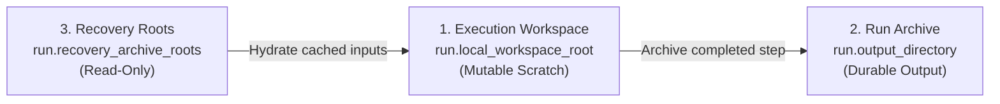

# Workspace and Archive Layout

PILATES separates mutable execution scratch space from durable run archives and read-only recovery stores across three directory tiers.

## Three-Tier Directory Hierarchy

| Tier | Config Key | Mutability | Purpose |
| --- | --- | --- | --- |
| **1. Execution Workspace** | `run.local_workspace_root` | Mutable scratch | Holds active container bind mounts, intermediate preprocessor files, and live `.consist/` state during run execution. |
| **2. Run Archive** | `run.output_directory` | Durable write-once per step | Stores promoted stage outputs, config snapshots, workflow state, and the canonical `.consist/provenance.duckdb` database. |
| **3. Recovery Roots** | `run.recovery_archive_roots` | Read-only | Supplies historical archives and cold `.consist/provenance.duckdb` catalogs for cross-run cache hits, artifact hydration, and warm starts. |



See [Configuration Reference](../run/configuration_reference.md) for configuring these paths in `config.yaml` and [Step Contracts](../workflow/step_contracts.md) for how recovery roots participate in cache lookups.

## Execution Workspace Layout (`run.local_workspace_root`)

During an active run, PILATES prepares simulator working directories inside `run.local_workspace_root` (or the repository workspace root when unset) and scopes Consist step runs under `<parent_run_id>/<model>/<run_id>`:

```text
<workspace_root>/
├── run_state.yaml                 # Persisted WorkflowState checkpoint for restart/resume
├── provenance/
│   ├── provenance.duckdb          # Live DuckDB provenance index and artifact catalog
│   └── <scenario_id>/
│       └── <model>/<run_id>/      # Step-scoped Consist run directory and consist.json
├── pilates/
│   ├── urbansim/data/             # Staged UrbanSim HDF5 datastores, skims, and static inputs
│   ├── atlas/
│   │   ├── atlas_input/           # Year-scoped ATLAS CSV inputs and static inputs
│   │   └── atlas_output/          # Year-scoped ATLAS householdv and vehicles outputs
│   ├── activitysim/
│   │   ├── data*/                 # Mutable ActivitySim input tables and OMX skims
│   │   ├── configs*/              # Mutable ActivitySim configs (staged by ensure_activitysim_mutable_configs)
│   │   └── output/                # ActivitySim output tables and Zarr skims
│   ├── beam/
│   │   ├── test/input/<region>/   # Mutable BEAM workspace (staged by ensure_beam_mutable_workspace)
│   │   └── beam_output/           # BEAM simulation outputs
│   └── postprocessing/
│       └── output/                # Year/iteration archived outputs (year-{year}-iteration-{iter})
```

## Run Archive Layout (`run.output_directory`)

As each year and iteration finishes, postprocessors write durable outputs under `pilates/postprocessing/output/` (or `run.output_directory/<scenario_id>/`), and when `run.enable_archive_copy: true` is configured, `execute_step()` configures Consist's `RunCompletionArchivePolicy` to mirror completed step outputs into `<archive_run_dir>/consist-recovery/<scope>`:

```text
<archive_run_dir>/
├── year-{year}-iteration-{iter}/  # Durable per-year/iteration archived model outputs
└── consist-recovery/              # Optional Consist recovery archive mirror (when enable_archive_copy: true)
    └── <scenario_id>/
        └── <model>/<run_id>/      # Step-scoped mirrored artifacts for cold-scratch hydration
```

## Key Workspace and Archive Files

| File / Directory | Role |
| --- | --- |
| `run_state.yaml` | Records the active forecast year, inner iteration, completed stage checkpoints, and restart metadata for scenario resume. |
| `provenance/provenance.duckdb` | Stores step execution records, Merkle input/config hashes, coupler artifact URIs, and queryable facets. Query this file with [Analysis Overview](../analysis/overview.md) or [SQL and DuckDB](../analysis/sql_and_duckdb.md). |
| `provenance/<scenario_id>/<model>/<run_id>/consist.json` | Step-scoped human-readable JSON provenance log emitted by Consist. |
| `consist-recovery/<scenario_id>/<model>/<run_id>/` | Optional durable mirror populated by Consist's `RunCompletionArchivePolicy` when `run.enable_archive_copy: true`, registered via `run.recovery_archive_roots` for cold-scratch cache hydration. |
