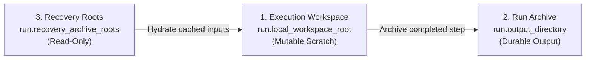

# Workspace and Archive Layout

PILATES separates mutable execution scratch space from durable run archives and read-only recovery stores across three directory tiers.

## Three-Tier Directory Hierarchy

| Tier | Config Key | Mutability | Purpose |
| --- | --- | --- | --- |
| **1. Execution Workspace** | `run.local_workspace_root` | Mutable scratch | Holds active container bind mounts, intermediate preprocessor files, and live `.consist/` state during run execution. |
| **2. Run Archive** | `run.output_directory` | Durable write-once per step | Stores promoted stage outputs, config snapshots, workflow state, and the canonical `.consist/provenance.duckdb` database. |
| **3. Recovery Roots** | `run.recovery_archive_roots` | Read-only | Supplies historical archives and cold `.consist/provenance.duckdb` catalogs for cross-run cache hits, artifact hydration, and warm starts. |



See [Configuration Reference](../run/configuration_reference.md) for configuring these paths in `config.yaml` and [Step Contracts](../workflow/step_contracts.md) for how recovery roots participate in cache lookups.

## Execution Workspace Layout (`run.local_workspace_root`)

During an active run, PILATES prepares simulator working directories inside `run.local_workspace_root/<run_id>/`:

```text
<local_workspace_root>/<run_id>/
├── .consist/
│   ├── provenance.duckdb          # Live DuckDB provenance index during execution
│   └── consist.json               # Dual-write JSON provenance log
├── urbansim/                      # Mounted UrbanSim input/output stores
├── atlas/                         # Year-scoped ATLAS input and output folders
├── activitysim/                   # Mounted /configs, /data, and /output directories
└── beam/                          # BEAM scenario staging and iteration working dirs
```

## Run Archive Layout (`run.output_directory`)

As each step finishes, `pilates/runtime/run_output_archive.py` promotes validated outputs and provenance metadata into `run.output_directory`:

```text
<output_directory>/
├── config_snapshot.yaml           # Resolved configuration snapshot for the run
├── workflow_state.yaml            # Current forecast year, iteration, and stage pointers
├── run_state.yaml                 # Launcher lifecycle metadata and timestamps
├── stage_outputs/
│   ├── initialize/                # Base-year stores and initial skims
│   ├── year_2010/
│   │   ├── land_use/              # Promoted UrbanSim and ATLAS artifacts
│   │   ├── demand_iter_0/         # Promoted ActivitySim tables
│   │   └── supply_iter_0/         # Promoted BEAM skims, linkstats, and events
│   └── postprocess/               # Final summary artifacts
└── .consist/
    ├── provenance.duckdb          # Canonical DuckDB database for analysis and recovery
    ├── consist.json               # Human-readable JSON run log
    ├── recovery_promotion.json    # Audit record of artifacts hydrated from recovery roots
    └── snapshots/
        └── latest/                # Snapshot of the latest consistent provenance state
```

## Key Archive Files

| File / Directory | Role |
| --- | --- |
| `config_snapshot.yaml` | Captures the merged configuration (after overlays and CLI overrides) used to execute the run. |
| `workflow_state.yaml` | Records the active `year`, replanning `iteration`, and latest artifact paths for resume and warm-start inspection. |
| `.consist/provenance.duckdb` | Stores step execution records, Merkle input/config hashes, coupler artifact URIs, and ingested `dlt` tables. Query this file with [Analysis Overview](../analysis/overview.md) or [SQL and DuckDB](../analysis/sql_and_duckdb.md). |
| `.consist/recovery_promotion.json` | Lists artifacts copied or linked from `run.recovery_archive_roots` when a step hits the cache. |
| `stage_outputs/` | Contains the durable artifact files referenced by relative container URIs inside `.consist/provenance.duckdb`. |
