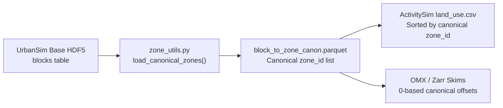

# Zone ID and Skim Alignment

UrbanSim, ATLAS, ActivitySim, and BEAM exchange demographic tables and origin-destination skim matrices indexed by Traffic Analysis Zones (`TAZ` / `zone_id`) and Census blocks (`block_id`). PILATES enforces a single canonical zone ordering and 0-based matrix alignment across all four simulators through `pilates/utils/zone_utils.py`.

## Canonical Zone Ordering

### Source of Truth

`load_canonical_zones(...)` and `get_block_to_zone_mapping(...)` in `pilates/utils/zone_utils.py` derive the canonical zone list from the base-year UrbanSim HDF5 store (`blocks` table) and cache the mapping at `pilates/urbansim/data/block_to_zone_canon.parquet`.

| Simulator | Geographic Key | Alignment Requirement |
| --- | --- | --- |
| **UrbanSim** | `block_id` (15-digit FIPS string) and `zone_id` | Every block maps to a canonical `zone_id` present in the regional skim matrix. |
| **ATLAS** | `block_id` and `zone_id` | Inherits `zone_id` assignments from UrbanSim `households` and `blocks` tables. |
| **ActivitySim** | `zone_id` (in `land_use.csv`) and 0-based matrix offset | Requires `land_use.csv` rows and skim matrix axes to follow identical canonical zone order. |
| **BEAM** | `taz` / `zone_id` | Emits origin-destination skims indexed by TAZ ID, which the postprocessor re-indexes to 0-based canonical offsets. |



## Land Use and Skim Matrix Alignment

### Skim Source Precedence

To prepare inputs for UrbanSim and ActivitySim, the step input resolver selects skim artifacts in the following order:

1. **`ZARR_SKIMS`**: Preferred when `zarr_skims` is published on the coupler (`skims.zarr`).
2. **`FINAL_SKIMS_OMX` / `OMX_SKIMS`**: Used when Zarr skims are absent (`skims.omx`).

### 0-Based Indexing for ActivitySim and Zarr

ActivitySim indexes skim matrices using 0-based positional offsets (`0 .. N-1`). `ensure_0_based_and_flag_zarr_skims(...)` in `pilates/utils/zone_utils.py` aligns Zarr and OMX skims with `land_use.csv`:

1. Loads the canonical `zone_id` sequence from `load_canonical_zones(...)`.
2. Reorders `land_use.csv` so row `i` corresponds to canonical zone `i`.
3. Re-indexes Zarr `orig` and `dest` coordinates to `0 .. N-1` and writes an alignment attribute flag so subsequent steps can verify 0-based indexing without re-sorting.

## Safeguards and Verification

Preprocessors and postprocessors raise a `ValueError` if any of the following conditions occur:

- A household or building `block_id` in UrbanSim lacks a mapping in `block_to_zone_canon.parquet`.
- The set of `zone_id` values in `land_use.csv` differs from the zones present in the active OMX or Zarr skim store.
- A Zarr skim store passed to ActivitySim has non-zero-based coordinates or mismatched matrix dimensions.

Run the standalone verification script to audit zone consistency across an existing data directory or run archive:

```bash
python scripts/verify_zone_ids.py
```
