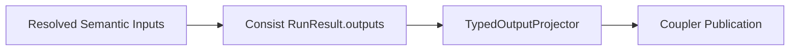

# Scenario Lifecycle

A PILATES run moves through five phases: startup initialization, pre-scenario bootstrap, Consist scenario context setup, the simulation year loop, and shutdown snapshotting.

## 1. Startup

At startup (`python run.py`), `pilates.runtime.launcher.main()` executes these steps:

1. Parses CLI flags (`-c/--config`, `-S/--stage`, `--allow-rewind-resume`) and loads the YAML configuration with Pydantic validation.
2. Initializes runtime flags (`init_runtime_from_config`) and builds the immutable `WorkflowPlan`, which determines the enabled stages, step contracts, and expected outputs for the run.
3. Creates a fresh `WorkflowState` or restores an existing state from the `run_state.yaml` path passed via `-S/--stage`.
4. Resolves the durable archive directory (`<run.output_directory>/pilates-run--<region>--<name>--<timestamp>/`) and the mutable execution directory (`<run.local_workspace_root>/pilates-run--.../` when set, or colocated inside the archive directory).
5. Initializes the Consist `Tracker` against the archive directory (`.consist/provenance.duckdb`), mounts repository inputs and the mutable workspace, and restores or seeds the run-local DuckDB when configured.
6. Creates the `Workspace` (`pilates/workspace.py`) inside the mutable run directory, sets up model working subdirectories, and writes `run_state.yaml` to both the archive directory and the local workspace.

## 2. Bootstrap

Bootstrap (`pilates/runtime/bootstrap.py`) runs once before the main Consist scenario context opens. It stages immutable regional inputs from the repository into the mutable workspace and records bootstrap artifact handles for downstream stages:

- **Synthetic population and land-use base data**: Stages the regional HDF5 datastore (`custom_mpo_<region_id>_model_data.h5`) from `pilates/urbansim/data/` into `<workspace>/urbansim/data/`. Even when `land_use` is disabled, bootstrap stages this datastore if `activity_demand` or `vehicle_ownership` is enabled.
- **Canonical zone coordinates**: Generates and logs `canonical_zones.parquet` from `activitysim.canonical_zones_source` (or `shared.geography.zones.source`) so ActivitySim and BEAM share aligned zone centroids.
- **Model input and config trees**: Stages ActivitySim inputs and config folders (`configs`, `configs_extended`, `configs_mp`, `configs_sh_compile`), initial OMX skims, BEAM production configs and `r5/` router inputs, and ATLAS inputs into their mutable workspace directories.
- **Inbound admission validation**: Evaluates optional `admission` policies (`urbansim.admission.initial_datastore`, `activitysim.admission.initial_skims`, `beam.admission.linkstats`) before model execution begins.

On restart (`data_initialized: true` in `run_state.yaml`), restart preflight checks which local workspace files are present and re-runs the bootstrap staging steps needed to restore missing workspace invariants. If `run.restart_strict: true` is set, the launcher fails fast after bootstrap if any required restart artifact remains missing.

## 3. Scenario Context and Year Loop

After bootstrap completes, the launcher opens the Consist scenario context (`ScenarioEngine`), declares the coupler output schema from the active `WorkflowPlan`, and seeds the coupler with the bootstrap artifacts (`canonical_zones`, `initial_datastore`, `omx_skims`, and `beam_warmstart_linkstats`).

For each simulation year from `run.start_year` to `run.end_year`, `ScenarioEngine` executes the enabled stages in fixed order:

1. **Land Use (`land_use` / UrbanSim)**: Runs for simulation years after `start_year` at intervals of `run.land_use_freq`, projecting households, persons, jobs, and parcels for the target year.
2. **Vehicle Ownership (`vehicle_ownership` / ATLAS)**: Runs when enabled at `run.vehicle_ownership_freq`, updating household vehicle ownership tables from land-use outputs and travel skims.
3. **Supply and Demand Loop (`activity_demand` / ActivitySim and `travel` / BEAM)**: Executes `run.supply_demand_iters` feedback iterations for the current travel year:
   - **ActivitySim**: Resolves land-use and skim inputs from the coupler, runs `activitysim_preprocess` and `activitysim_run`, and publishes updated demand plans (`plans`, `households`, `persons`).
   - **BEAM**: Runs `beam_preprocess`, executes the simulation container in `beam_run`, and runs `beam_postprocess` to merge iteration skims into Zarr skims (`zarr_skims`) and extract linkstats and events.
4. **Postprocessing (`postprocessing`)**: Runs output validation checks when enabled at the end of the travel year.

Each stage resolves its semantic inputs once from the coupler, runs its native Consist `@define_step` functions, projects `RunResult.outputs` into typed stage outputs, and updates `run_state.yaml`.



At the end of each stage and outer year, the launcher snapshots `.consist/provenance.duckdb` to `.consist/snapshots/latest/`.

## 4. Restart and Resume

PILATES coordinates stage-level restart policy through `WorkflowState` (`run_state.yaml`), while Consist manages artifact identity, cache admission, and output hydration.

### Normal Stage and Year Frontier Resume

To resume an interrupted run, pass the archived `run_state.yaml` path via `-S/--stage`:

```bash
python run.py -c path/to/settings.yaml -S /path/to/archive_run_dir/run_state.yaml
```

Outside the committed BEAM mid-stage checkpoint described below, restart resumes at the next incomplete stage or year recorded in `run_state.yaml`. Interrupted steps within UrbanSim, ATLAS, or ActivitySim do not resume mid-step; they re-run from the start of that stage on the next launch.

### Rewind Resume (`--allow-rewind-resume`)

By default, `pilates/runtime/restart.py` blocks restarts when `run.start_year` in the YAML config is earlier than the `current_year` recorded in `run_state.yaml`. Pass `--allow-rewind-resume` on the command line when you want to rewind an archived state file to an earlier year frontier and re-run from that year.

### The `beam_run_completed -> beam_postprocess` Mid-Stage Boundary

BEAM travel execution is split into two separate Consist `@define_step` steps to protect multi-hour container runs from postprocessing failures:

1. `beam_run`: Runs the BEAM container and commits verified raw outputs into `archive_run_dir`, recording `beam_run_completed` in `run_state.yaml`.
2. `beam_postprocess`: Merges raw iteration skims into the cumulative Zarr skims store and extracts link statistics and events.

If a job fails or hits a walltime limit after `beam_run` commits but before `beam_postprocess` finishes:

- Restarting with `-S <archive_run_dir>/run_state.yaml` recognizes the `beam_run_completed` checkpoint and cache-hits `beam_run`.
- If the node-local mutable workspace was wiped between jobs, Consist (`cache_hydration="outputs-requested"`) hydrates the required `beam_run` outputs from `archive_run_dir`.
- `beam_postprocess` runs without re-executing the BEAM container.

### `beam_postprocess` Separate Stores and Idempotency

`beam_postprocess` treats its input skims store (`zarr_skims`) as read-only and writes merged iteration skims into a new run-scoped output store (`<beam_output_dir>/.pilates-consist-outputs/beam_postprocess/year-<year>-iteration-<iteration>/skims.zarr`) in a single pass:

- If `beam_postprocess` crashes mid-execution, the upstream `zarr_skims` store remains unmodified.
- On restart, PILATES cache-hits `beam_run`, discards any partial output store at the destination path, and re-runs `beam_postprocess` against the intact input skims without double-merging trips.
- Subsequent iterations bind `ZARR_SKIMS` from the latest output store published to the coupler rather than reading a static in-place workspace path.

## 5. Shutdown

At the end of the simulation year loop (or on early exit), the launcher flushes pending background archive-copy tasks, stops the archive worker thread, and writes a final snapshot of `.consist/provenance.duckdb` into `.consist/snapshots/latest/` inside `archive_run_dir`. If the snapshot step fails, the launcher copies the local DuckDB file to the archive path so the archive directory retains the complete provenance record.

## Related Pages

- Check [CLI](cli.md) for invocation flags and Slurm submission commands.
- Consult [Configuration Reference](configuration_reference.md) for `run.restart_strict` and `run.consist_db_*` settings.
- Read [Architecture](../workflow/architecture.md) and [Step Contracts](../workflow/step_contracts.md) for coupler and step execution design.
