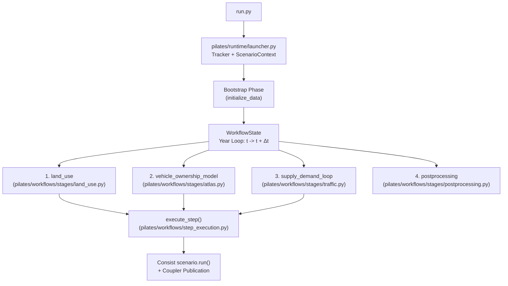
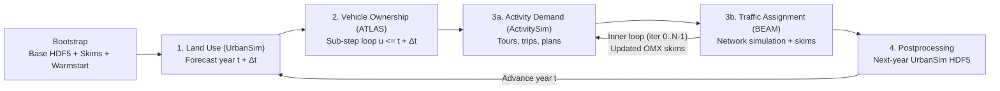

# Workflow Architecture

PILATES coordinates four urban and transportation models across discrete simulation years. This page defines the runtime control flow, the stage and step hierarchy, and the domain simulation logic executed in each stage.

## Control Flow

A simulation run passes through four runtime layers:

1. **Entry point (`run.py`)**: Parses command-line arguments and delegates execution to `pilates.runtime.launcher.main()`.
2. **Runtime launcher and state loop (`pilates/runtime/launcher.py` and `workflow_state.py`)**: Resolves the active `PilatesConfig`, workspace directories, and Consist `Tracker`. The launcher opens a top-level Consist `ScenarioContext` (`with tracker.scenario(...) as scenario:`), runs the pre-scenario `bootstrap` initialization phase, and constructs a `WorkflowState` state machine. `WorkflowState` advances through each forecast interval $(t, t + \Delta t)$ and yields the ordered stages for that year.
3. **Stage runners (`pilates/workflows/stages/`)**: Each stage runner (`run_land_use_stage`, `run_atlas_stage`, `run_supply_demand_loop`, `run_postprocessing_stage`) manages stage-level state, sub-loops, and model enablement checks. Stage runners invoke canonical workflow steps rather than calling container binaries or file manipulators in stage code.
4. **Step execution and provenance (`pilates/workflows/step_execution.py`)**: `execute_step()` binds declared upstream artifacts from `scenario.coupler`, resolves step identity (`StepIdentity`), materializes required inputs into the workspace, and calls `scenario.run()` to execute or hydrate the step. Upon completion, `execute_step()` archives declared outputs into the year/iteration archive, updates `scenario.coupler`, and projects validated `StepOutputsBase` paths back to the stage runner.

## Stages and Canonical Steps

`WorkflowState` advances each simulation year through four major orchestration stages after the one-time `bootstrap` phase. Within the step catalog (`pilates/workflows/catalog.py`), the `supply_demand_loop` stage divides into two catalog stages (`activity_demand` and `traffic_assignment`) that repeat for each inner replanning iteration.

Every tracked step belongs to one of three execution phases:

- **`preprocess`**: Translates canonical coupler artifacts into model-native workspace inputs.
- **`run`**: Executes the domain model (inside a container or local Python environment) and emits model-native outputs.
- **`postprocess`**: Validates model outputs, merges or transforms tables into canonical archive artifacts, and publishes updated keys to `scenario.coupler`.

| Orchestration Stage | Catalog Stage | Canonical Step Name | Phase | Tracked in Consist | Execution Condition |
| :--- | :--- | :--- | :--- | :--- | :--- |
| `bootstrap` | *(pre-scenario)* | `initialize_data` | `run` | Yes (`initialization`) | Runs once before the year loop starts. |
| `land_use` | `land_use` | `urbansim_run` | `run` | Yes | `land_use_enabled` (`travel_model_only=False` and `urbansim` configured). |
| `land_use` | `land_use` | `urbansim_postprocess` | `postprocess` | Yes | `land_use_enabled`. |
| `vehicle_ownership_model` | `vehicle_ownership_model` | `atlas_preprocess` | `preprocess` | Yes | `atlas_enabled` (`atlas` configured) for each scheduled ATLAS sub-year. |
| `vehicle_ownership_model` | `vehicle_ownership_model` | `atlas_run` | `run` | Yes | `atlas_enabled`. |
| `vehicle_ownership_model` | `vehicle_ownership_model` | `atlas_postprocess` | `postprocess` | Yes | `atlas_enabled`. |
| `supply_demand_loop` | `activity_demand` | `activitysim_preprocess` | `preprocess` | Yes | `activity_demand_enabled`; runs on iteration `0` (`iter == -1` when warm-starting). |
| `supply_demand_loop` | `activity_demand` | `activitysim_run` | `run` | Yes | `activity_demand_enabled`. |
| `supply_demand_loop` | `activity_demand` | `activitysim_postprocess` | `postprocess` | Yes | `activity_demand_enabled`. |
| `supply_demand_loop` | `traffic_assignment` | `beam_preprocess` | `preprocess` | Yes | `traffic_assignment_enabled` (`beam` configured). |
| `supply_demand_loop` | `traffic_assignment` | `beam_run` | `run` | Yes | `traffic_assignment_enabled`. |
| `supply_demand_loop` | `traffic_assignment` | `beam_postprocess` | `postprocess` | Yes | `traffic_assignment_enabled`. |
| `supply_demand_loop` | `traffic_assignment` | `beam_full_skim` | `run` | Yes (optional) | Optional full-skim pass (`beam.full_skim.enabled=True`). |
| `postprocessing` | `postprocessing` | `postprocessing` | `postprocess` | No | Runs at the end of the simulation year; generates next-year UrbanSim inputs when `land_use_enabled` is true. |

## Simulation Logic by Stage

### Bootstrap (`initialize_data`)

Before entering the year loop, `run_bootstrap_phase()` seeds the workspace and registers initial artifacts in `scenario.coupler`:

- Copies mutable configuration directories (`asim_mutable_data_dir`, `beam_mutable_data_dir`) into the workspace.
- Validates and registers the base-year UrbanSim datastore (`usim_datastore_h5` / `usim_datastore_base_h5`) and initial travel skims (`omx_skims`).
- Registers optional BEAM warm-start linkstats (`linkstats_warmstart`) and plan archives when configured.

### Stage 1: Land Use (`land_use`)

UrbanSim forecasts household, person, job, and real-estate development from base year $t$ to forecast year $t + \Delta t$ using zone-to-zone travel accessibility skims (`omx_skims`) from the prior year.

- **`urbansim_run`**: Stages the current UrbanSim HDF5 datastore (`usim_datastore_h5`) and `omx_skims` into the UrbanSim data directory, runs the UrbanSim container for forecast year $t + \Delta t$, and writes `model_data_{forecast_year}.h5` (`usim_forecast_output`).
- **`urbansim_postprocess`**: Extracts forecast `households`, `persons`, `jobs`, and `blocks` tables from `usim_forecast_output` alongside base-year fallback tables from `usim_datastore_base_h5`, publishing `usim_population_source_h5` and the extracted population tables for downstream consumers.

When `travel_model_only: true` is set in the scenario configuration, `WorkflowState` skips `land_use` and downstream stages read population tables from the base UrbanSim datastore (`usim_datastore_h5`).

### Stage 2: Vehicle Ownership (`vehicle_ownership_model`)

ATLAS updates household vehicle holdings (`cars`/`vehicl` counts and detailed vehicle fleet tables) between year $t$ and $t + \Delta t$. Because ATLAS can run on a finer cadence than the main simulation step (controlled by `atlas.step_size`), `run_atlas_stage()` iterates an internal `AtlasSubState` across each scheduled `atlas_year` $u \le t + \Delta t$:

- **`atlas_preprocess`**: Reads the latest UrbanSim HDF5 datastore (`usim_h5_updated` from an earlier ATLAS sub-year, `usim_population_source_h5` from UrbanSim, or `usim_datastore_h5` in travel-model-only mode) and exports year-specific CSV inputs into `atlas_input/{atlas_year}/`.
- **`atlas_run`**: Executes the ATLAS container against the staged inputs and `omx_skims`, writing `vehicles_{atlas_year}.csv` (`atlas_vehicles2_output`) and updated household vehicle counts into `atlas_output/`.
- **`atlas_postprocess`**: Writes ATLAS vehicle ownership predictions back into the UrbanSim HDF5 datastore (`usim_h5_updated`), updating `households[cars]` and `households[vehicl]` and storing the `atlas_vehicles` table inside the HDF5 archive.

### Stage 3: Supply-Demand Loop (`supply_demand_loop`)

`run_supply_demand_loop()` executes the inner equilibrium loop (`iteration = 0 .. replan_iters - 1`, or starting at `iteration = -1` when warm-starting ActivitySim before year-loop convergence). Each iteration couples ActivitySim (`activity_demand`) with BEAM (`traffic_assignment`):

- **`activitysim_preprocess`**: Runs once at the start of the supply-demand loop for the year (`iteration == 0`, or `iteration == -1` on warm start). Reads the updated HDF5 datastore (`usim_h5_updated` when ATLAS ran, `usim_population_source_h5` when UrbanSim ran without ATLAS, or `usim_datastore_h5` in travel-model-only mode) and `omx_skims`, then generates `land_use.csv`, `households.csv`, and `persons.csv` (`land_use_asim_in`, `households_asim_in`, `persons_asim_in`). On subsequent inner iterations (`iteration > 0`), ActivitySim reuses the population tables from iteration `0` alongside updated `omx_skims` from BEAM.
- **`activitysim_run`**: Runs ActivitySim to simulate long-term choices (workplace, school, auto ownership when ATLAS is disabled) and daily activity-travel tours and trips. On replanning iterations (`iteration > 0`), ActivitySim can restrict simulation to a replanning subsample (`replan_hh_samp_size`) starting at model step `replan_after`.
- **`activitysim_postprocess`**: Validates and archives ActivitySim outputs (`asim_output_dir`), exposing `plans.csv`, `households.csv`, `persons.csv`, `tours.csv`, and `trips.csv`.
- **`beam_preprocess`**: Aligns ActivitySim demand (`asim_output_dir`) and optional ATLAS fleet tables (`atlas_vehicles2_output`) into BEAM scenario inputs (`plans_beam_in`, `households_beam_in`, `persons_beam_in`, `vehicles_beam_in`). On iteration `0`, it seeds configured prior-year warmstart plans and linkstats; on replanning iterations (`iteration > 0`), it merges replanned households with prior-iteration BEAM plans (`beam_output_plans_xml` / `beam_output_experienced_plans_xml`).
- **`beam_run`**: Runs the BEAM mesoscopic multimodal simulation container and emits raw iteration outputs (`beam_output_dir`), including network skims, linkstats, events, and experienced plans.
- **`beam_postprocess`**: Resolves canonical BEAM outputs (`final_skims_omx`, `zarr_skims`, `linkstats`, `beam_network_final`, `beam_plans_out`, `beam_experienced_plans_xml`), updates the cross-model `omx_skims` handle for the next inner iteration or next simulation year, and copies updated `linkstats` into the BEAM warmstart location when across-year replanning is active.
- **`beam_full_skim` (optional)**: When `beam.full_skim.enabled` is true, runs a supplementary full-skim pass after the supply-demand loop to generate `beam_full_skims` (`full_skims_{year}.omx`).

### Stage 4: Postprocessing (`postprocessing`)

At the end of the simulation year (`t + \Delta t`), `run_postprocessing_stage()` prepares state for the next forecast interval:

- When `land_use_enabled` is true, `generate_next_year_urbansim_input()` merges the forecast year's tables (`usim_h5_updated` or `usim_population_source_h5`) into a new HDF5 datastore for year $t + \Delta t$, archives it under `usim_input_archive_{forecast_year}` and `usim_input_next`, and rebinds `usim_datastore_h5` in `scenario.coupler` so the next simulation year starts from the updated population and land-use state.
- Runs post-year archive cleanup according to the scenario retention policy.

## Related Documentation

- [Step Contracts & Execution](step_contracts.md): Step definitions, input binding, Consist identity, and typed output projection.
- [Artifact Flow, Roles & Facets](artifact_flow.md): Coupler keys, semantic roles, and provenance facets.
- [Lineage Map](lineage_map.md): Step-by-step artifact producers, consumers, and file paths.
- [Model Boundaries](../reference/model_boundaries.md): Handoff invariants between UrbanSim, ATLAS, ActivitySim, and BEAM.
