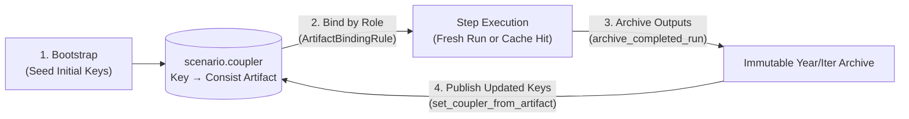

# Artifact Flow, Roles & Facets

In a multi-model workflow, each simulator writes files into its own directory structure using its own naming conventions—and those file locations change across forecast years, supply-demand iterations, and optional stages. If ActivitySim or BEAM had to guess where the latest population HDF5 or travel skims lived on disk, disabling a model (like ATLAS or UrbanSim) or resuming from a cache hit would break downstream path assumptions.

PILATES solves this with **`scenario.coupler`**, an in-memory artifact switchboard attached to the active Consist `ScenarioContext`.

## What `scenario.coupler` Is and What We Rely On It To Do

`scenario.coupler` is a dictionary-like registry mapping **canonical artifact keys** (defined in `pilates/workflows/artifact_keys.py`, such as `usim_datastore_h5`, `final_skims_omx`, or `plans_beam_in`) to tracked Consist **`Artifact`** records. Each `Artifact` holds both the physical file URI and its cryptographic content hash.

PILATES relies on `scenario.coupler` for four core responsibilities:

1. **Decouple consumers from upstream directory layouts**: Downstream steps never construct paths into an upstream model's output folder. A step asks the coupler for a semantic key (or an ordered fallback list of keys via `ArtifactBindingRule`), and Consist copies the resolved file into the step's local working directory.
2. **Track the "latest" version of evolving state across years and iterations**: As the simulation advances, models overwrite keys in `scenario.coupler` with newly archived artifacts. For example, `omx_skims` starts at bootstrap as the warm-start skim file and is updated after every `beam_postprocess` pass so the next iteration or forecast year automatically binds the newest travel times.
3. **Adapt cleanly when optional stages are enabled or disabled**: When ATLAS is enabled, `atlas_postprocess` publishes `usim_h5_updated` and `atlas_vehicles2_output` to the coupler; when ATLAS is disabled, those keys remain unset and downstream steps (`activitysim_preprocess`, `beam_preprocess`) fall back to the UrbanSim or bootstrap population keys.
4. **Propagate content identity for caching and provenance**: Because `scenario.coupler` stores Consist `Artifact` objects rather than raw string paths, every coupler handoff automatically records a producer-to-consumer lineage edge in `provenance.duckdb` and feeds the exact input file digest into the downstream step's cache key.



### The Four-Step Artifact Lifecycle

Every file that crosses a step boundary moves through `scenario.coupler` in four steps:

1. **Bootstrap registration**: Before the simulation year loop starts, `run_bootstrap_phase()` registers initial seed artifacts in `scenario.coupler` (including `usim_datastore_h5`, `usim_datastore_base_h5`, `omx_skims`, `asim_mutable_data_dir`, `beam_mutable_data_dir`, and optional warm-start files).
2. **Role-based binding**: When `execute_step()` starts a step, `resolve_inputs()` evaluates the step's `ArtifactBindingRule` list against `scenario.coupler` and materializes the selected artifacts into the workspace (`resolved_inputs.logical_destinations`).
3. **Immutable archiving**: After `scenario.run()` completes, `archive_completed_run()` copies the step's declared outputs from the working directory into the immutable year/iteration archive under `<output_folder>/<year>/` (or `<output_folder>/<year>/iter_<iteration>/`).
4. **Coupler publication**: `execute_step()` binds each archived `Artifact` into `scenario.coupler` via `set_coupler_from_artifact()`, updating that key for downstream steps in the same year or subsequent years.

!!! tip "Inspecting Exact File Paths"
    For step-by-step workspace paths, archive paths, and producer-consumer tables, see the [Lineage Map](lineage_map.md).

---

## Canonical Coupler Keys by Domain

All canonical coupler keys live in `pilates/workflows/artifact_keys.py` (`ArtifactKeys`). Several keys point to files with similar formats (such as HDF5 datastores, OMX skims, or BEAM plan files) that serve distinct roles in the workflow.

=== "UrbanSim & Population (`usim_*`)"

    | Coupler Key | Producer | Primary Consumers | Semantic Role |
    | :--- | :--- | :--- | :--- |
    | `usim_datastore_h5` (`USIM_DATASTORE_CURRENT_H5`) | `initialize_data`, `postprocessing` | `urbansim_run`, `atlas_preprocess`, `activitysim_preprocess` | Active UrbanSim HDF5 datastore for the start of the current simulation year. `USIM_DATASTORE_H5` is a compatibility alias for this key. |
    | `usim_datastore_base_h5` | `initialize_data` | `urbansim_postprocess`, `atlas_preprocess`, `postprocessing` | Immutable base-year UrbanSim HDF5 datastore registered at bootstrap. Used as a fallback source for static geometry or base-year tables absent from forecast outputs. |
    | `usim_forecast_output` | `urbansim_run` | `urbansim_postprocess` | Raw `model_data_{forecast_year}.h5` file emitted by the UrbanSim container before table extraction. |
    | `usim_population_source_h5` | `urbansim_postprocess`, `atlas_postprocess` | `atlas_preprocess`, `activitysim_preprocess`, `postprocessing` | Postprocessed UrbanSim HDF5 datastore snapshot for the forecast year (updated by ATLAS when vehicle ownership is enabled). |
    | `usim_h5_updated` | `atlas_postprocess` | `atlas_preprocess` (subsequent sub-years), `activitysim_preprocess`, `postprocessing` | UrbanSim HDF5 datastore enriched with ATLAS household vehicle counts (`cars`, `vehicl`) and the `atlas_vehicles` table. |
    | `usim_population_households_table`, `usim_population_persons_table`, `usim_population_jobs_table`, `usim_population_blocks_table` | `urbansim_postprocess` | `activitysim_preprocess`, analytics | Extracted population and land-use tables (`households`, `persons`, `jobs`, `blocks`) logged as individual artifacts. |
    | `usim_input_next` / `usim_input_archive_{forecast_year}` | `postprocessing` | Next simulation year (`usim_datastore_h5`) | Assembled next-year UrbanSim HDF5 input datastore archived at the end of year $t + \Delta t$. |

=== "ATLAS Fleet (`atlas_*`)"

    | Coupler Key | Producer | Primary Consumers | Semantic Role |
    | :--- | :--- | :--- | :--- |
    | `atlas_households_csv`, `atlas_persons_csv`, `atlas_blocks_csv`, `atlas_residential_csv`, `atlas_jobs_csv` | `atlas_preprocess` | `atlas_run` | Prepared yearly CSV input tables extracted from the UrbanSim datastore for the ATLAS container. |
    | `householdv_{forecast_year}`, `vehicles_{forecast_year}` | `atlas_run` | `atlas_postprocess` | Raw household and vehicle fleet tables emitted by ATLAS for the forecast year. |
    | `atlas_vehicles2_output` | `atlas_postprocess` | `beam_preprocess` | Detailed household vehicle fleet table (`vehicles_{forecast_year}.csv`) with body type, fuel/powertrain, and vintage attributes staged for BEAM. |

=== "ActivitySim Demand (`*_asim_*`)"

    | Coupler Key | Producer | Primary Consumers | Semantic Role |
    | :--- | :--- | :--- | :--- |
    | `asim_mutable_data_dir` | `initialize_data` | `activitysim_preprocess`, `activitysim_run` | Mutable ActivitySim data directory copied into the workspace at bootstrap. |
    | `land_use_asim_in`, `households_asim_in`, `persons_asim_in` | `activitysim_preprocess` | `activitysim_run`, `activitysim_postprocess` | Preprocessed CSV input tables (`land_use.csv`, `households.csv`, `persons.csv`) formatted for ActivitySim. |
    | `beam_plans_asim_out`, `households_asim_out`, `persons_asim_out`, `tours_asim_out`, `trips_asim_out` | `activitysim_run`, `activitysim_postprocess` | `activitysim_postprocess`, `beam_preprocess` | Canonical ActivitySim output tables published after demand simulation and postprocessing. |
    | `accessibility_asim_out` | `activitysim_run`, `activitysim_postprocess` | `urbansim_postprocess`, `postprocessing` | Zone-level accessibility table merged back into the HDF5 datastore for the next land-use forecast year. |

=== "BEAM Traffic (`*_beam_*` & `linkstats*`)"

    | Coupler Key | Producer | Primary Consumers | Semantic Role |
    | :--- | :--- | :--- | :--- |
    | `beam_mutable_data_dir` | `initialize_data` | `beam_preprocess`, `beam_run`, `beam_full_skim` | Mutable BEAM scenario and configuration directory in the workspace. |
    | `plans_beam_in`, `households_beam_in`, `persons_beam_in`, `vehicles_beam_in` | `beam_preprocess` | `beam_run` | Active BEAM scenario input CSVs staged for the current year and inner iteration. |
    | `linkstats_warmstart` | `initialize_data`, `beam_postprocess` | `beam_preprocess`, `beam_run` | Prior-year or bootstrap link travel-time statistics (`*.linkstats.csv.gz`) used to warm-start BEAM network assignment. |
    | `linkstats` | `beam_postprocess` | `beam_preprocess` (warmstart update), analysis | Final iteration link statistics (`{last_iter}.linkstats.csv.gz`) promoted from `beam_run`. |
    | `beam_network_final` | `beam_postprocess` | Analysis and network inspection | Final road and transit network table (`network.csv.gz`) emitted by BEAM. |
    | `beam_plans_out` / `beam_output_plans_xml` | `beam_postprocess` | `beam_preprocess` (next iteration/year) | Merged agent plans (`plans.csv.gz` / `output_plans.xml.gz`) carried forward across replanning iterations. |
    | `beam_experienced_plans_xml` / `beam_output_experienced_plans_xml` | `beam_postprocess` | `beam_preprocess` (next iteration/year) | Experienced plans with simulated travel times and scores (`experiencedPlans.xml.gz`) used by plan-memory selection in `beam_preprocess`. |

=== "Cross-Model Skims (`*skims*`)"

    | Coupler Key | Producer | Primary Consumers | Semantic Role |
    | :--- | :--- | :--- | :--- |
    | `omx_skims` (`OMX_SKIMS` / `ASIM_OMX_SKIMS`) | `initialize_data`, `beam_postprocess` | `urbansim_run`, `atlas_preprocess`, `activitysim_preprocess`, `activitysim_run` | Active cross-model zone-to-zone OMX travel skim matrix (`skims.omx`). Initialized at bootstrap and updated after each `beam_postprocess` execution. |
    | `final_skims_omx` | `beam_postprocess`, `beam_full_skim` | `atlas_preprocess`, `activitysim_preprocess`, `postprocessing` | Year-and-iteration-stamped OMX skim archive produced by converting BEAM skims at the end of a BEAM pass. |
    | `zarr_skims` | `beam_postprocess` | `activitysim_run`, analysis | Multi-dimensional Zarr skim store (`skims.zarr`) preserving fine-grained BEAM skim dimensions across iterations. |
    | `beam_full_skims` | `beam_full_skim` | Analysis | Optional full-origin-destination skim matrix produced when `beam.full_skim` is enabled. |

---

## Queryable Facets in DuckDB

While `scenario.coupler` manages live artifact handoffs during a run, **facets** make completed runs and artifacts easy to query afterward in `<workspace>/provenance/provenance.duckdb` without parsing filenames or directory trees.

PILATES attaches two kinds of structured facets (indexed with `facet_index=True`, which does not alter cache hashes):

=== "Run & Step Facets"

    `pilates/utils/consist_config.py` and `pilates/workflows/step_consist_meta.py` attach structured configuration facets to the top-level scenario header and to every step execution:

    | Scope / Step Family | `facet_schema_version` | Key Facet Fields |
    | :--- | :--- | :--- |
    | Scenario header (`tracker.scenario`) | `pilates_scenario_v1` | `run` (`PilatesRunConfig.to_consist_facet()`, including `scenario_id`, `region`, `start_year`, `end_year`, `travel_model_only`, stage enablement flags). |
    | Bootstrap (`initialization`) | `initialization_v1` | Same `run` facet payload as the parent scenario header. |
    | UrbanSim (`urbansim_run`, `urbansim_postprocess`) | `urbansim_run_v1`, `urbansim_postprocess_v1` | Full `UrbanSimConfig` dump (`region_id`, templates, admission config) plus `native_input_contract`. |
    | ATLAS (`atlas_preprocess`, `atlas_run`, `atlas_postprocess`) | `atlas_preprocess_v1`, `atlas_run_v1`, `atlas_postprocess_v1` | Full `AtlasConfig` dump plus runtime identity fields: `atlas_subyear`, `main_forecast_year`, `atlas_usim_households_sha256`, `atlas_usim_households_row_count`. |
    | ActivitySim (`activitysim_preprocess`, `activitysim_run`, `activitysim_postprocess`) | `activitysim_preprocess_v1`, `activitysim_run_v1`, `activitysim_postprocess_v1` | `ActivitySimConfig.to_consist_facet()` (`household_sample_size`, `chunk_size`, `num_processes`, `replan_iters`, `replan_hh_samp_size`, `random_seed`). |
    | BEAM (`beam_preprocess`, `beam_run`, `beam_postprocess`, `beam_full_skim`) | `beam_preprocess_v1`, `beam_run_v1`, `beam_postprocess_v1`, `beam_full_skim_v1` | `BeamConfig.to_consist_facet()` (`config`, `sample`, `replanning_portion`, `memory`, plan memory parameters, `write_skims_to_omx`, `full_skim`). |
    | Postprocessing (`postprocessing`) | `postprocessing_v1` | `PostprocessingConfig` dump. |

    In addition to the JSON `facet` dictionary, Consist stores first-class columns on every `Run` row in DuckDB: `id`, `model_name`, `year`, `iteration`, `parent_run_id` (the scenario ID), and `status`.

=== "Artifact Facets (`linkstats`)"

    `pilates/beam/runner.py` also attaches artifact-level facets (`facet_schema_version="v1"`, `facet_index=True`) to unmodified physical-simulation linkstats Parquet files produced inside BEAM sub-iterations (`linkstats_unmodified_phys_sim_iter_parquet`), so analysts can filter them with `consist.find_artifacts()` instead of regex-matching filenames:

    | Field | Type | Meaning |
    | :--- | :--- | :--- |
    | `artifact_family` | `str` | Constant `"linkstats_unmodified_phys_sim_iter_parquet"`. |
    | `year` | `int` | Simulation forecast year (for example, `2018`). |
    | `iteration` | `int` | PILATES supply-demand loop iteration (`WorkflowState.current_inner_iter`). |
    | `phys_sim_iteration` | `int` | Physical simulation suffix `N` parsed from `*.physSimIter-{N}.linkstats.unmodified.parquet`. |
    | `beam_sub_iteration` | `int` | BEAM internal `ITERS/it.{M}` sub-iteration index `M` (recorded on both intermediate and promoted final artifacts). |

    ```python
    import consist

    # Fetch all unmodified physSimIter linkstats Parquet artifacts for year 2018, iteration 0
    artifacts = consist.find_artifacts(
        tracker=tracker,  # (1)!
        facet={
            "artifact_family": "linkstats_unmodified_phys_sim_iter_parquet",
            "year": 2018,
            "iteration": 0,
        },
    )

    # Narrow to a specific BEAM sub-iteration and physical simulation iteration
    artifact = consist.find_artifact(
        tracker=tracker,
        facet={
            "artifact_family": "linkstats_unmodified_phys_sim_iter_parquet",
            "year": 2018,
            "iteration": 0,
            "beam_sub_iteration": 1,  # (2)!
            "phys_sim_iteration": 2,
        },
    )
    ```

    1. Queries `<workspace>/provenance/provenance.duckdb` using indexed facet columns rather than scanning the filesystem.
    2. Matches both intermediate (`beam_sub_iter1`) and promoted final sub-iteration artifacts by structured metadata.

## Related Documentation

- [Workflow Architecture](architecture.md): Control flow, stages, and simulation logic.
- [Step Contracts & Execution](step_contracts.md): Input binding rules, `execute_step()`, and Consist configuration channels.
- [Lineage Map](lineage_map.md): Complete step-by-step artifact producers, consumers, and file paths.
- [SQL & DuckDB Recipes](../analysis/sql_and_duckdb.md): Querying run and artifact facets in `provenance.duckdb`.
