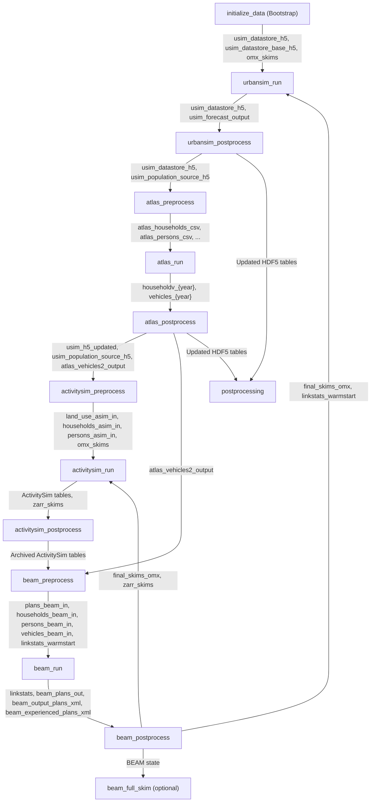

# Lineage Map

This page provides a step-by-step reference of the artifacts consumed and published by each canonical step in the PILATES workflow. For high-level coupler mechanics, semantic key definitions, and queryable run/artifact facets, see [Artifact Flow, Roles & Facets](artifact_flow.md).

## End-to-End Lineage Diagram

## Summary of Step Inputs and Outputs

| Step Name | Stage | Consumed Roles / Keys | Published Keys |
| :--- | :--- | :--- | :--- |
| `initialize_data` | `bootstrap` | Configured input paths in `PilatesConfig` | `usim_datastore_h5`, `usim_datastore_base_h5`, `omx_skims`, `asim_mutable_data_dir`, `beam_mutable_data_dir`, optional `linkstats_warmstart` |
| `urbansim_run` | `land_use` | `usim_datastore_h5`, optional `final_skims_omx` / `omx_skims` | `usim_datastore_h5`, `usim_forecast_output` |
| `urbansim_postprocess` | `land_use` | `usim_datastore_h5`, optional `usim_datastore_base_h5` | `usim_datastore_h5`, `usim_population_source_h5`, `usim_input_merged_{year}`, `usim_input_archive_{year}` |
| `atlas_preprocess` | `vehicle_ownership_model` | `usim_datastore_h5`, `usim_datastore_base_h5`, optional `final_skims_omx` | `atlas_households_csv`, `atlas_blocks_csv`, `atlas_persons_csv`, `atlas_residential_csv`, `atlas_jobs_csv`, optional `atlas_grave_csv`, optional `atlas_accessibility_csv` |
| `atlas_run` | `vehicle_ownership_model` | Prepared ATLAS CSVs from `atlas_preprocess` | `householdv_{year}`, `vehicles_{year}`, `atlas_continuation_{year}` (`vehicles_output.RData`, `households_output.RData`) |
| `atlas_postprocess` | `vehicle_ownership_model` | `householdv_{year}`, `vehicles_{year}`, `usim_datastore_h5` | `usim_population_source_h5`, `usim_h5_updated`, `atlas_vehicles2_output` |
| `activitysim_preprocess` | `activity_demand` | `usim_population_source_h5` (or fallback datastore), optional `final_skims_omx` | `land_use_asim_in`, `households_asim_in`, `persons_asim_in`, `omx_skims` |
| `activitysim_run` | `activity_demand` | `land_use_asim_in`, `households_asim_in`, `persons_asim_in`, `zarr_skims` or `omx_skims` | ActivitySim run tables (`plans`, `households`, `persons`, `tours`, `trips`), `zarr_skims` |
| `activitysim_postprocess` | `activity_demand` | `land_use_asim_in`, `households_asim_in`, `persons_asim_in`, `omx_skims`, `zarr_skims`, ActivitySim run outputs, optional UrbanSim HDF5 roles | Archived ActivitySim tables (`persons_asim_out`, `trips_asim_out`, `tours_asim_out`, `beam_plans_asim_out`, `households_asim_out`), `usim_input_merged_{year}` |
| `beam_preprocess` | `traffic_assignment` | ActivitySim demand tables, optional `atlas_vehicles2_output`, optional `linkstats_warmstart` and prior BEAM plans | `plans_beam_in`, `households_beam_in`, `persons_beam_in`, `vehicles_beam_in`, `linkstats_warmstart`, `beam_input_*_archived` |
| `beam_run` | `traffic_assignment` | `plans_beam_in`, `households_beam_in`, `persons_beam_in`, `vehicles_beam_in`, `linkstats_warmstart` | `linkstats`, `beam_plans_out`, `beam_output_plans_xml`, `beam_experienced_plans_xml`, `beam_output_experienced_plans_xml` |
| `beam_postprocess` | `traffic_assignment` | `beam_run` outputs | `zarr_skims`, `final_skims_omx`, `omx_skims`, `linkstats`, `beam_network_final`, `linkstats_unmodified_parquet__*` |
| `beam_full_skim` | `traffic_assignment` | Staged BEAM scenario and network outputs | `beam_full_skims` |
| `postprocessing` | `postprocessing` | Forecast-year HDF5 tables and base datastore | `usim_input_next`, `usim_input_archive_{year}`, updated `usim_datastore_h5` |

## Stage-by-Stage Lineage Details

### Bootstrap (`initialize_data`)

- **Reads**: Scenario configuration paths from `PilatesConfig`.
- **Publishes**: Initial `usim_datastore_h5`, `usim_datastore_base_h5`, `omx_skims`, `asim_mutable_data_dir`, `beam_mutable_data_dir`, and optional `linkstats_warmstart`.
- **Downstream handoff**: Registers all bootstrap-safe inputs in `scenario.coupler` so downstream steps resolve initial files through standard binding rules rather than ad-hoc filesystem lookups.

### Land Use (`land_use`)

#### `urbansim_run`

- **Reads**:
  - `usim_datastore_h5` (`USIM_DATASTORE_CURRENT_H5`) materialized to `<usim_mutable_data_dir>/<input_file_template>`.
  - `final_skims_omx` (`FINAL_SKIMS_OMX`, required on years following a prior BEAM pass, optional on the start year) materialized to `<usim_mutable_data_dir>/final_skims.omx`.
  - Static UrbanSim input files tracked via `identity_inputs`.
- **Publishes**:
  - `usim_datastore_h5` (`USIM_DATASTORE_CURRENT_H5`): Raw forecast HDF5 datastore (`model_data_{year}.h5`).
  - `usim_forecast_output` (`USIM_FORECAST_OUTPUT`): Forecast-year runner output reference.
- **Downstream handoff**: Supplies the raw forecast HDF5 datastore to `urbansim_postprocess` while preserving `usim_forecast_output` for audit and restart checks.

#### `urbansim_postprocess`

- **Reads**:
  - `usim_datastore_h5` from `urbansim_run`.
  - Optional `usim_datastore_base_h5` (`USIM_DATASTORE_BASE_H5`).
- **Publishes**:
  - `usim_datastore_h5`: Postprocessed mutable datastore.
  - `usim_population_source_h5` (`USIM_POPULATION_SOURCE_H5`): Immutable snapshot (`model_data_{year}_population_source.h5`) used as the population source for downstream models.
  - `usim_input_merged_{year}` (`USIM_INPUT_MERGED_PREFIX`): Merged input datastore for the forecast year.
  - `usim_input_archive_{year}` (`USIM_INPUT_ARCHIVE_PREFIX`): Archived input datastore (`input_data_for_{year}_outputs.h5`).
- **Downstream handoff**: After `urbansim_postprocess` finishes, `run_land_use_stage()` keeps `usim_datastore_base_h5`, `usim_datastore_h5`, `usim_forecast_output`, and `usim_population_source_h5` distinct in `scenario.coupler` so ATLAS and ActivitySim bind the exact HDF5 role they require.

### Vehicle Ownership (`vehicle_ownership_model`)

#### `atlas_preprocess`

- **Reads**:
  - `usim_datastore_h5` (`USIM_DATASTORE_H5`) and `usim_datastore_base_h5` (`USIM_DATASTORE_BASE_H5`).
  - `final_skims_omx` (`FINAL_SKIMS_OMX`, required when a prior BEAM skim handoff exists, optional otherwise) materialized to `<atlas_mutable_input_dir>/final_skims.omx`.
- **Publishes**:
  - Prepared CSV tables under `<atlas_mutable_input_dir>/year{forecast_year}/`: `atlas_households_csv` (`households.csv`), `atlas_blocks_csv` (`blocks.csv`), `atlas_persons_csv` (`persons.csv`), `atlas_residential_csv` (`residential.csv`), `atlas_jobs_csv` (`jobs.csv`), conditional `atlas_grave_csv` (`grave.csv` when `year > start_year`), and conditional `atlas_accessibility_csv` (`accessibility_{forecast_year}_tract.csv` when `atlas.beamac > 0`).
- **Downstream handoff**: Provides staged CSV inputs to `atlas_run` derived from the active UrbanSim datastore state.

#### `atlas_run`

- **Reads**:
  - All prepared CSV roles emitted by `atlas_preprocess`.
  - Static ATLAS model data tracked via `identity_inputs`.
- **Publishes**:
  - `householdv_{forecast_year}`: `<atlas_output_dir>/householdv_{forecast_year}.csv`.
  - `vehicles_{forecast_year}`: `<atlas_output_dir>/vehicles_{forecast_year}.csv`.
  - `atlas_continuation_{forecast_year}` (`OutputSet` containing `vehicles_output.RData` and `households_output.RData` under `<atlas_mutable_input_dir>/year{forecast_year}/`).
- **Downstream handoff**: Supplies predicted household vehicle counts and fleet tables to `atlas_postprocess`.

#### `atlas_postprocess`

- **Reads**:
  - `householdv_{forecast_year}` (`atlas_householdv_csv`), `vehicles_{forecast_year}` (`atlas_vehicles_csv`), and `usim_datastore_h5`.
- **Publishes**:
  - `usim_population_source_h5` (`USIM_POPULATION_SOURCE_H5`): Post-mutation HDF5 snapshot containing updated `households[cars]` and `households[vehicl]`.
  - `usim_h5_updated` (`USIM_H5_UPDATED`): Updated datastore role.
  - `atlas_vehicles2_output` (`ATLAS_VEHICLES2_OUTPUT`): Vehicle fleet table for BEAM.
- **Downstream handoff**: ActivitySim binds its population tables from `usim_population_source_h5` / `usim_h5_updated`, and `beam_preprocess` binds `atlas_vehicles2_output`.

### Activity Demand (`activity_demand`)

#### `activitysim_preprocess`

- **Reads**:
  - `usim_population_source_h5` (`USIM_POPULATION_SOURCE_H5`, or fallback datastore role when running without UrbanSim/ATLAS).
  - Optional `final_skims_omx` (`FINAL_SKIMS_OMX`).
- **Publishes**:
  - `land_use_asim_in` (`ASIM_LAND_USE_IN`), `households_asim_in` (`ASIM_HOUSEHOLDS_IN`), and `persons_asim_in` (`ASIM_PERSONS_IN`) with file schema profiling enabled.
  - `omx_skims` (`ASIM_OMX_SKIMS`).
- **Downstream handoff**: Stages the canonical CSV inputs and OMX skims consumed by `activitysim_run`.

#### `activitysim_run`

- **Reads**:
  - `land_use_asim_in`, `households_asim_in`, `persons_asim_in`.
  - `zarr_skims` (`ZARR_SKIMS`) when a shared Zarr skim store is already published in the coupler; otherwise `omx_skims` (`ASIM_OMX_SKIMS`).
- **Publishes**:
  - Configured ActivitySim output tables for the current year and iteration.
  - `zarr_skims` (`ZARR_SKIMS`) at `<asim_runtime_cache_dir>/skims.zarr` when converting from `omx_skims`.
- **Downstream handoff**: Supplies raw demand outputs to `activitysim_postprocess` and publishes `zarr_skims` for subsequent Zarr-mode ActivitySim iterations. Node-local Numba/Sharrow warmups during multiprocessing cache misses remain untracked runtime preparation.

#### `activitysim_postprocess`

- **Reads**:
  - `households_asim_in`, `persons_asim_in`, `land_use_asim_in`, `omx_skims`, `zarr_skims`, ActivitySim run outputs, and optional `usim_population_source_h5`, `usim_datastore_current_h5`, and `usim_datastore_base_h5`.
- **Publishes**:
  - Archived ActivitySim output artifacts (`persons_asim_out`, `trips_asim_out`, `tours_asim_out`, `beam_plans_asim_out`, `households_asim_out`).
  - `usim_input_merged_{year}` (`USIM_INPUT_MERGED_PREFIX`) tables used for archive and lineage inspection.
- **Downstream handoff**: Publishes the demand tables that `beam_preprocess` stages into BEAM scenario inputs.

### Traffic Assignment (`traffic_assignment`)

#### `beam_preprocess`

- **Reads**:
  - ActivitySim demand outputs (`plans`, `households`, `persons`), optional `atlas_vehicles2_output`, BEAM configuration files, and optional warm-start artifacts (`linkstats_warmstart`, prior-iteration or prior-year BEAM plans and experienced plans).
- **Publishes**:
  - Active BEAM inputs under `<beam_mutable_data_dir>/.pilates-consist-outputs/beam_preprocess/`: `plans_beam_in`, `households_beam_in`, `persons_beam_in`, `vehicles_beam_in`, and `linkstats_warmstart`.
  - Archived input snapshots (`beam_input_plans_archived`, `beam_input_households_archived`, `beam_input_persons_archived`, `beam_input_vehicles_archived`, `beam_input_config_archived`, `beam_input_config_references_archived`).
- **Downstream handoff**: Guarantees that `beam_run` reads resolver-staged, provenance-tracked inputs rather than mutable files left behind by earlier steps.

#### `beam_run`

- **Reads**:
  - `plans_beam_in`, `households_beam_in`, `persons_beam_in`, `vehicles_beam_in`, and optional `linkstats_warmstart`.
- **Publishes**:
  - `linkstats` (`LINKSTATS`), `beam_plans_out` (`BEAM_PLANS_OUT`), `beam_output_plans_xml` (`BEAM_OUTPUT_PLANS_XML`), `beam_experienced_plans_xml` (`BEAM_EXPERIENCED_PLANS_XML`), and `beam_output_experienced_plans_xml` (`BEAM_OUTPUT_EXPERIENCED_PLANS_XML`).
- **Downstream handoff**: Provides raw network performance and plan XML outputs to `beam_postprocess` and subsequent replanning iterations.

#### `beam_postprocess`

- **Reads**:
  - `beam_run` outputs (`linkstats`, plan XML outputs, and iteration skims).
- **Publishes**:
  - `zarr_skims` (`ZARR_SKIMS`) and `final_skims_omx` (`FINAL_SKIMS_OMX`).
  - Updated `omx_skims` and `linkstats_warmstart` handles in `scenario.coupler`.
  - Unmodified physical-simulation linkstats Parquet artifacts (`linkstats_unmodified_parquet__y{year}__i{iteration}__phys_sim_iter{N}`) indexed under the `linkstats_unmodified_phys_sim_iter_parquet` artifact facet family.
- **Downstream handoff**: Supplies updated travel skims and linkstats to the next inner supply-demand iteration or the next simulation year.

#### `beam_full_skim` (Optional)

- **Reads**:
  - Staged BEAM configuration and network state from the completed traffic assignment pass.
- **Publishes**:
  - `beam_full_skims` (`BEAM_FULL_SKIMS`).
- **Downstream handoff**: Produces a standalone full-matrix OMX skim artifact when `beam.full_skim.enabled` is true.

### Postprocessing (`postprocessing`)

- **Reads**: Forecast-year HDF5 tables (`usim_h5_updated` or `usim_population_source_h5`) and `usim_datastore_base_h5`.
- **Publishes**: `usim_input_next`, `usim_input_archive_{year}`, and updates `usim_datastore_h5` for the next simulation year.

## Restart and Resume Boundaries

- **Stage-boundary restarts**: Scenario restarts resume at the start of an orchestration stage, or at the single supported mid-stage boundary `beam_run_completed -> beam_postprocess`.
- **Coupler-driven recovery**: Resumed runs rehydrate `scenario.coupler` from persisted step records (`ZARR_SKIMS`, `USIM_POPULATION_SOURCE_H5`, `FINAL_SKIMS_OMX`, and BEAM plan XML keys) so resumed steps bind their upstream inputs through the same rules used in uninterrupted runs. See [Scenario Lifecycle](../run/scenario_lifecycle.md) for resume configuration details.

## Related Documentation

- [Workflow Architecture](architecture.md): High-level control flow, stages, and simulation logic.
- [Step Contracts & Execution](step_contracts.md): Step definitions, input binding, and Consist execution lifecycle.
- [Artifact Flow, Roles & Facets](artifact_flow.md): Coupler keys, semantic roles, and provenance facets.
- [Analysis Overview](../analysis/overview.md): Inspecting run archives and querying provenance data.
