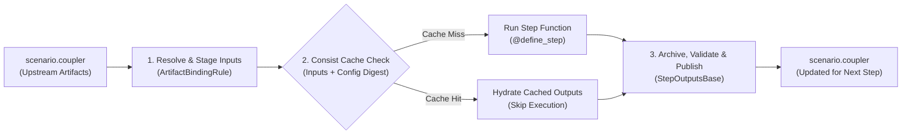

# Step Contracts & Execution

In PILATES, models never hardcode relative paths into another model's output directory. Instead, every step runs through a declarative **step contract** backed by Consist (`consist.ScenarioContext`).

A step contract answers three practical questions before and after a model runs:

1. **Where do my input files come from?** The step asks for inputs by logical role (such as `plans_beam_in` or `usim_datastore_h5`). PILATES resolves each role from `scenario.coupler` based on which upstream models are enabled and stages the file into the step's working directory.
2. **Do I need to run, or can I reuse a cached result?** Consist hashes the resolved input artifacts, step parameters, and mutable config files to decide whether to run the step function or restore cached outputs.
3. **What files did I produce for downstream models?** Whether the step ran fresh or hit the cache, PILATES validates the output files on disk, archives them, and publishes them under canonical keys in `scenario.coupler` for the next step.



---

## Anatomy of a Real Step (`beam_preprocess`)

Every step in `pilates/workflows/steps/` combines three pieces: a **`StepDefinition`** that declares how inputs and outputs bind to the workflow, a **`@define_step`** function that runs the model or adapter, and a **`StepOutputsBase`** dataclass that validates the produced files.

=== "1. Declare the Contract (`StepDefinition`)"

    In `pilates/workflows/steps/beam.py`, `beam_preprocess` binds its step function, input resolver, output projector, and `ArtifactBindingRule` fallback policies into a single `StepDefinition`:

    ```python
    beam_preprocess = StepDefinition(
        name="beam_preprocess",
        function=_native_beam_preprocess,  # (1)!
        resolve_inputs=_resolve_beam_preprocess_inputs,  # (2)!
        project_outputs=_project_beam_preprocess_outputs,  # (3)!
        input_contract=_BEAM_PREPROCESS_INPUT_CONTRACT,
        output_paths=_beam_preprocess_native_output_paths,
        binding_rules=(
            ArtifactBindingRule(
                semantic_key="plans_beam_in",
                required=True,
                preferred_keys=("beam_plans_asim_out", "plans_beam_in"),  # (4)!
            ),
            ArtifactBindingRule(
                semantic_key="households_beam_in",
                required=True,
                preferred_keys=("households_asim_out", "households_beam_in"),
            ),
            ArtifactBindingRule(
                semantic_key="persons_beam_in",
                required=True,
                preferred_keys=("persons_asim_out", "persons_beam_in"),
            ),
            ArtifactBindingRule(
                semantic_key="atlas_vehicles2_output",
                required=False,  # (5)!
                allow_fallback=False,
            ),
        ),
        optional_output_keys=("linkstats_warmstart", "vehicles_beam_in"),
    )
    ```

    1. The `@define_step` callable that Consist invokes on a cache miss.
    2. Inspects `scenario.coupler` and returns a frozen `ResolvedStepInputs` snapshot before the step starts.
    3. Converts Consist's persisted `RunResult.outputs` into a validated `BeamPreprocessOutputs` dataclass.
    4. Ordered fallback candidates: prefers ActivitySim's `beam_plans_asim_out` when ActivitySim is enabled, or falls back to bootstrap `plans_beam_in` in traffic-assignment-only runs.
    5. Optional upstream handoff: bound when ATLAS (`vehicle_ownership`) is enabled, and cleanly omitted when ATLAS is disabled.

=== "2. Run the Step Body (`@define_step`)"

    Consist materializes the resolved inputs to their workspace destinations and passes them as `Path` arguments to `_native_beam_preprocess`:

    ```python
    @define_step(
        model="beam_preprocess",
        name_template="beam_preprocess__y{year}__i{iteration}__phase_{phase}",
        inputs={
            "plans_beam_in": None,
            "households_beam_in": None,
            "persons_beam_in": None,
        },
        optional_input_keys=(
            "linkstats_warmstart",
            "atlas_vehicles2_output",
            "beam_plans_out",
        ),
        schema_outputs=[
            "plans_beam_in",
            "households_beam_in",
            "persons_beam_in",
            "linkstats_warmstart",
            "vehicles_beam_in",
        ],
        input_binding="paths",  # (1)!
    )
    def _native_beam_preprocess(
        plans_beam_in: Path,  # (2)!
        households_beam_in: Path,
        persons_beam_in: Path,
        linkstats_warmstart: Path | None = None,
        atlas_vehicles2_output: Path | None = None,
        beam_plans_out: Path | None = None,
        *,
        settings: PilatesConfig,
        state: WorkflowState,
        workspace: Workspace,
        _consist_ctx: Any,
        beam_preprocess_context: Mapping[str, Any] | None = None,
    ) -> None:
        inputs = {
            "plans_beam_in": plans_beam_in,
            "households_beam_in": households_beam_in,
            "persons_beam_in": persons_beam_in,
        }
        if atlas_vehicles2_output is not None:
            inputs["atlas_vehicles2_output"] = atlas_vehicles2_output

        produced = BeamPreprocessor("beam_preprocess", state).preprocess(  # (3)!
            workspace,
            beam_preprocess_inputs=inputs,
            beam_preprocess_context=beam_preprocess_context,
        )
        _validate_native_outputs(
            produced,
            step_name="beam_preprocess",
            settings=settings,
            state=state,
            workspace=workspace,
        )
    ```

    1. Instructs Consist to materialize bound artifacts on disk and pass local `Path` objects to the function parameters.
    2. Each parameter name matches a bound input key from `ResolvedStepInputs`. No ad-hoc path assembly or coupler lookups happen inside the function.
    3. Delegates domain logic to `BeamPreprocessor`, which writes the prepared CSVs into `workspace.get_beam_mutable_data_dir()`.

=== "3. Project & Validate Outputs (`StepOutputsBase`)"

    After Consist finishes (either by running `_native_beam_preprocess` or hydrating cached files), `project_outputs` constructs `BeamPreprocessOutputs` (`pilates/beam/outputs.py`) and validates that all required files exist on disk:

    ```python
    @dataclass
    class BeamPreprocessOutputs(StepOutputsBase):
        primary_output_attr: ClassVar[str] = "beam_mutable_data_dir"
        declared_outputs: ClassVar[Tuple[str, ...]] = (  # (1)!
            "plans_beam_in",
            "households_beam_in",
            "persons_beam_in",
            "linkstats_warmstart",
            "vehicles_beam_in",
        )
        required_outputs: ClassVar[Tuple[str, ...]] = (  # (2)!
            "plans_beam_in",
            "households_beam_in",
            "persons_beam_in",
        )
        required_path_fields: ClassVar[Tuple[str, ...]] = ("beam_mutable_data_dir",)
        dict_path_fields: ClassVar[Tuple[str, ...]] = ("prepared_inputs",)  # (3)!

        beam_mutable_data_dir: Path
        prepared_inputs: Dict[str, Path] = field(default_factory=dict)
    ```

    1. Canonical output keys published to `scenario.coupler` for downstream steps (`beam_run`).
    2. Outputs that must be present on every run. `vehicles_beam_in` and `linkstats_warmstart` are optional because they depend on whether ATLAS or warmstart linkstats are active.
    3. `StepOutputsBase.validate()` verifies that `beam_mutable_data_dir` and every `Path` inside `prepared_inputs` exist on disk before returning control to the stage runner.

---

## How Input Binding Adapts to Active Models

Because PILATES supports modular workflows (for example, running ActivitySim + BEAM without UrbanSim, or inserting ATLAS between UrbanSim and ActivitySim), a step cannot assume a single upstream producer.

`ArtifactBindingRule` decouples **what a step needs** (`semantic_key`) from **which upstream step produced it** (`preferred_keys` and `fallback_provider`).

=== "ATLAS Prep (`atlas_preprocess`)"

    When ATLAS prepares its yearly CSV inputs in `pilates/workflows/steps/atlas.py`, it needs the current UrbanSim HDF5 datastore and optional OMX travel skims:

    ```python
    binding_rules=(
        ArtifactBindingRule(
            semantic_key="usim_datastore_current_h5",
            required=True,
            allow_fallback=True,
            preferred_keys=("usim_datastore_current_h5", "usim_h5_updated"),  # (1)!
        ),
        ArtifactBindingRule(
            semantic_key="omx_skims",
            required=False,
            allow_fallback=True,
            preferred_keys=("final_skims_omx", "omx_skims"),  # (2)!
        ),
    )
    ```

    1. Checks `scenario.coupler` for `usim_datastore_current_h5` (produced by `urbansim_run`), falling back to `usim_h5_updated` or the year's staged datastore when running standalone.
    2. Uses `final_skims_omx` from a prior BEAM iteration when available, or falls back to initial `omx_skims`.

=== "ActivitySim Postprocess (`activitysim_postprocess`)"

    When `activitysim_postprocess` merges accessibility tables back into the HDF5 datastore in `pilates/workflows/steps/activitysim.py`, its binding rules adapt across three different workflow configurations:

    ```python
    binding_rules=(
        ArtifactBindingRule(
            semantic_key="usim_datastore_current_h5",
            required=False,
            preferred_keys=("usim_datastore_current_h5",),  # (1)!
        ),
        ArtifactBindingRule(
            semantic_key="usim_datastore_base_h5",
            required=False,
            allow_fallback=True,
            fallback_provider="activitysim_input_datastore",  # (2)!
        ),
        ArtifactBindingRule(
            semantic_key="usim_population_source_h5",
            required=False,
            allow_fallback=True,
            preferred_keys=("usim_population_source_h5",),
            fallback_provider="activitysim_population_source",  # (3)!
        ),
    )
    ```

    1. Present when `urbansim_run` ran earlier in the same forecast year.
    2. Resolves the base-year HDF5 datastore when running in travel-model-only mode (`land_use: null`).
    3. Resolves the post-ATLAS population snapshot (`usim_population_source_h5`) when ATLAS modified household vehicles earlier in the year.

If a required role has no matching key in `scenario.coupler` and no permitted fallback, `resolved_inputs.require_complete()` fails immediately—before launching any container—and reports the step name, missing role, and candidate keys checked.

---

## Runtime Execution: Fresh Run vs. Cache Hit

Stage runners (such as `pilates/workflows/stages/supply_demand_activity.py`) invoke every step through `execute_step()` in `pilates/workflows/step_execution.py`:

```python
_, preprocess_outputs = execute_step(
    scenario=scenario,
    definition=activitysim_preprocess,
    settings=settings,
    state=state,
    workspace=workspace,
    stage="supply_demand",
    year=population_year,
    iteration=inputs.iteration,
    phase="preprocess",
)
```

Before calling `scenario.run()`, `execute_step()` computes the step's cache signature from three Consist configuration channels built by `pilates/utils/consist_config.py`:

| Channel | Consist Parameter | In Cache Hash? | What It Captures |
| :--- | :--- | :--- | :--- |
| **Identity Config** | `config` | Yes | Canonical simulation parameters that change model outputs (sample sizes, replanning parameters, command templates, admission policies). |
| **Identity Inputs** | `identity_inputs` | Yes | Digests of mutable workspace config trees outside the artifact graph (`asim_mutable_configs` for ActivitySim; `beam_conf/*` and linkstats expectations for BEAM). |
| **Queryable Facet** | `facet` | No | Indexed metadata written to `provenance.duckdb` (`facet_index=True`) for cross-run SQL queries. |

Once Consist compares the step signature (inputs + `config` + `identity_inputs` + code identity) against `provenance.duckdb`, execution follows one of two paths:

=== "Cache Miss (Fresh Execution)"

    When no matching run exists in `provenance.duckdb` (or `cache_mode` forces execution):

    1. **Materialize inputs**: Consist copies the bound input artifacts into the workspace paths declared in `resolved_inputs.logical_destinations`.
    2. **Run step function**: Consist invokes `definition.function` (`@define_step`), which runs the preprocessor, container runner, or postprocessor and writes outputs to the workspace.
    3. **Record provenance**: Consist hashes the newly written output files, logs them in `consist.json` and `provenance.duckdb`, and returns `RunResult`.
    4. **Archive & publish**: `execute_step()` copies outputs to the year/iteration archive (`archive_completed_run()`) and updates `scenario.coupler`.
    5. **Project & validate**: `definition.project_outputs()` builds the `StepOutputsBase` instance and runs file existence and semantic `OutputValidator` checks.

=== "Cache Hit (Hydrated Execution)"

    When `scenario.cache_mode == "reuse"` and the input/config digests match a prior completed run:

    1. **Skip step function**: Consist does **not** invoke `definition.function` or launch the model container.
    2. **Hydrate outputs to workspace**: Consist restores the cached output files directly into the step's workspace destination paths (`cache_hydration="outputs-requested"`).
       - *Safety fallback*: If an archived file from the prior run is missing or unreadable on disk, `cache_hydration_failure="miss"` automatically falls back to a fresh execution.
    3. **Archive & publish**: `execute_step()` runs the exact same `archive_completed_run()` and `scenario.coupler` publication step as a fresh run.
    4. **Project & validate**: `definition.project_outputs()` constructs and validates the exact same `StepOutputsBase` dataclass.

!!! important "Downstream Invariant"
    Downstream steps cannot tell whether an upstream step ran live or hydrated from cache: in both cases, the same files exist at the same workspace paths and the same keys are registered in `scenario.coupler`.

---

## Core Contract Types Reference

When adding or debugging a workflow step, you will primarily interact with four dataclasses:

=== "`StepDefinition`"

    Defined in `pilates/workflows/step_definition.py` and instantiated in `pilates/workflows/steps/*.py`.

    | Field | Type | Purpose |
    | :--- | :--- | :--- |
    | `name` | `str` | Canonical step name (e.g., `activitysim_preprocess`, `beam_run`). |
    | `function` | `Callable[..., None]` | The `@define_step`-decorated step implementation. |
    | `resolve_inputs` | `Callable[..., ResolvedStepInputs]` | Resolves coupler artifacts and workspace destinations before execution. |
    | `project_outputs` | `TypedOutputProjector[OutputT]` | Builds and validates the step's `StepOutputsBase` dataclass from `RunResult.outputs`. |
    | `input_contract` | `InputContract` | Declares cache-eligibility status (`complete` or `incomplete`) and `ConfigContract` mode. |
    | `output_paths` | `Callable[..., Mapping[str, Any]] \| None` | Maps canonical output keys to expected workspace file paths. |
    | `output_sets` | `Callable[..., Mapping[str, OutputSet]] \| None` | Declares multi-file directory output sets (such as ATLAS `.RData` continuation files). |
    | `binding_rules` | `tuple[ArtifactBindingRule, ...]` | Step-owned rules mapping semantic roles to candidate coupler keys. |
    | `optional_output_keys` | `tuple[str, ...]` | Output keys that may be omitted when optional model features are inactive. |
    | `preflight_identity` | `bool` | When `True`, resolves `StepIdentity` before calling `resolve_inputs`. |
    | `archive_outputs` | `bool` | When `True` (default), archives outputs and publishes them to `scenario.coupler` after `scenario.run()`. |

=== "`ArtifactBindingRule`"

    Defined in `pilates/workflows/binding.py` and attached to `StepDefinition.binding_rules`.

    | Field | Type | Purpose |
    | :--- | :--- | :--- |
    | `semantic_key` | `str` | Role name expected by the step (e.g., `plans_beam_in`, `usim_datastore_current_h5`). |
    | `required` | `bool` | Whether `require_complete()` should fail if the role cannot be bound. |
    | `preferred_keys` | `tuple[str, ...]` | Ordered candidate keys checked from left to right in `scenario.coupler`. |
    | `allow_fallback` | `bool` | Whether the resolver may query `fallback_provider` when coupler keys are absent. |
    | `fallback_provider` | `str \| None` | Named fallback strategy for bootstrap or standalone stage runs. |
    | `pass_mode` | `Literal[...]` | Controls whether the artifact is passed as a path/key (`"auto"`) or recorded as `"metadata_only"`. |

=== "`ResolvedStepInputs`"

    Defined in `pilates/workflows/resolved_inputs.py` and returned by `definition.resolve_inputs()`.

    | Field | Type | Purpose |
    | :--- | :--- | :--- |
    | `step_name` | `str` | Step identifier that owns this input selection. |
    | `binding` | `BindingResult \| ResolvedBinding` | Consist binding payload mapping role names to resolved `Artifact` objects. |
    | `required_roles` / `optional_roles` | `tuple[str, ...]` | Declared required and optional roles for completeness checking. |
    | `source_by_role` | `Mapping[str, str]` | Diagnostic map recording whether each role came from `coupler`, `fallback`, or `missing`. |
    | `selected_key_by_role` | `Mapping[str, str]` | Diagnostic map recording which candidate key won fallback selection. |
    | `logical_destinations` | `Mapping[str, Path]` | Target workspace paths where Consist materializes each bound input before invoking the step. |

=== "`WorkflowStepSpec`"

    Defined in `pilates/workflows/catalog.py` (`WORKFLOW_STEP_SPECS`) to describe static workflow ordering and stage policy.

    | Field | Type | Purpose |
    | :--- | :--- | :--- |
    | `step_name` | `str` | Canonical step name matching `StepDefinition.name` in `STEP_DEFINITIONS`. |
    | `stage_name` & `phase` | `str` | Owning workflow stage (`land_use`, `vehicle_ownership_model`, `activity_demand`, `traffic_assignment`, `postprocessing`) and phase (`preprocess`, `run`, `postprocess`). |
    | `order` & `depends_on` | `int`, `Tuple[str, ...]` | Deterministic execution index and upstream step dependencies. |
    | `enabled_flag_attr` & `enabled_model_attr` | `Optional[str]` | Attributes on `WorkflowState` and `PilatesConfig` that gate whether the step runs. |
    | `provenance` | `Optional[WorkflowStepProvenanceSpec]` | Selects the config builder in `pilates/utils/consist_config.py`. |
    | `dynamic_input_families` / `dynamic_output_families` | `Tuple[str, ...]` | Parameterized coupler key patterns (e.g., `householdv_{forecast_year}`) expanded at runtime. |

## Related Documentation

- [Workflow Architecture](architecture.md): High-level control flow, stages, and simulation loop.
- [Artifact Flow, Roles & Facets](artifact_flow.md): Coupler keys, semantic roles, and provenance facets.
- [Lineage Map](lineage_map.md): Step-by-step artifact producers, consumers, and file paths.
- [Adding a Model](../extend/adding_a_model.md): Implementing new `StepDefinition` and `StepOutputsBase` contracts.
- [Output Validation](../extend/output_validation.md): Writing semantic `OutputValidator` checks.
