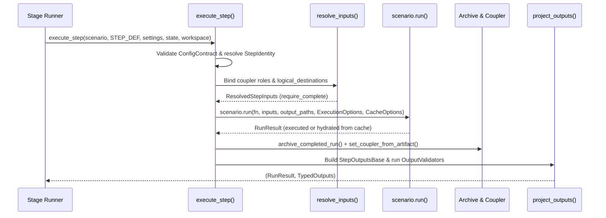

# Step Contracts & Execution

PILATES executes every tracked workflow step through a declarative contract layer backed by Consist (`consist.ScenarioContext`). This page documents the catalog and step definition structures, the `execute_step()` runtime sequence, input binding and materialization, output projection, and provenance caching semantics.

## Architecture of a Step Contract

PILATES separates static workflow topology from step execution mechanics across three core types:

### 1. Catalog Topology (`WorkflowStepSpec`)

`pilates/workflows/catalog.py` defines `WORKFLOW_STEP_SPECS`, an ordered tuple of `WorkflowStepSpec` records. Each `WorkflowStepSpec` declares:

- **`name`**: Canonical step identifier (for example, `activitysim_preprocess` or `beam_run`).
- **`stage` and `phase`**: Catalog stage (`land_use`, `vehicle_ownership_model`, `activity_demand`, `traffic_assignment`, `postprocessing`) and execution phase (`preprocess`, `run`, `postprocess`).
- **`order` and `depends_on`**: Deterministic ordering index and upstream step names.
- **`enabled_flag_attr` and `enabled_model_attr`**: Attributes on `WorkflowState` and `PilatesConfig` that gate whether the step runs.
- **`provenance_builder_key`**: Key into `pilates/utils/consist_config.py` (`urbansim`, `atlas`, `activitysim`, `beam`, `postprocessing`) used to build Consist identity configurations and facets.
- **`dynamic_input_families` and `dynamic_output_families`**: Parameterized coupler key templates (such as `usim_input_merged_{forecast_year}_{table_name}`) expanded at runtime.

### 2. Executable Step Contract (`StepDefinition`)

Each step module under `pilates/workflows/steps/` exposes a `StepDefinition[OutputT]` instance (`pilates/workflows/step_definition.py`) that binds a Python callable decorated with `@define_step` to its input and output contracts:

- **`function`**: Step implementation callable accepting `settings`, `state`, `workspace`, and `resolved_inputs` (plus explicit Consist-bound path parameters on path-bound steps).
- **`resolve_inputs`**: `InputResolver` callable returning a frozen `ResolvedStepInputs` object.
- **`project_outputs`**: `TypedOutputProjector[OutputT]` callable that maps persisted `RunResult.outputs` back into a validated `StepOutputsBase` dataclass.
- **`input_contract`**: `InputContract` holding a `ConfigContract` (expected `settings` type, `state` type, and required `PilatesConfig` sections) and an optional `ArtifactBindingSpec`.
- **`binding_rules`**: Tuple of `ArtifactBindingRule` objects mapping logical role names to candidate coupler keys.
- **`output_paths` and `output_sets`**: Output key declarations mapping canonical coupler keys to workspace paths before Consist finishes the step.
- **`optional_output_keys`**: Output keys that a step may omit when optional model features are inactive.
- **`preflight_identity`**: Boolean flag indicating whether `execute_step()` resolves Consist identity (`StepIdentity`) before invoking `scenario.run()`.
- **`archive_outputs`**: Boolean flag controlling automatic post-step archiving (`archive_completed_run()`) and coupler publication.

### 3. Frozen Input Resolution (`ResolvedStepInputs`)

`ResolvedStepInputs` (`pilates/workflows/resolved_inputs.py`) captures the resolved input state before step execution starts:

- **`binding`**: `BindingResult` mapping logical role names to resolved Consist `Artifact` objects, alongside `missing_required` and `unresolved_optional` role tuples.
- **`required_roles` and `optional_roles`**: Declared role tuples for the step.
- **`source_by_role` and `selected_key_by_role`**: Lineage metadata recording whether each role resolved from `coupler` or `bootstrap`, and which candidate key won fallback selection.
- **`logical_destinations`**: Mapping of role names to target workspace `Path` destinations for Consist path materialization.

## The `execute_step()` Lifecycle

Stage runners invoke steps through `execute_step()` in `pilates/workflows/step_execution.py`:

```python
_, preprocess_outputs = execute_step(
    scenario,
    ACTIVITYSIM_PREPROCESS_STEP,
    settings=settings,
    state=state,
    workspace=workspace,
)
```

For each invocation, `execute_step()` performs seven ordered operations:

1. **Validate configuration contract**: Calls `definition.input_contract.config.validate(settings, state)` to verify runtime types and required `PilatesConfig` sections.
2. **Resolve preflight identity**: When `definition.preflight_identity` is `True`, calls `resolve_step_identity()` (`pilates/utils/consist_StepIdentity.py`) via `build_step_consist_kwargs()` to compute the Consist `config` dictionary, `facet` dictionary, `facet_schema_version`, and `identity_inputs` digests.
3. **Resolve and freeze inputs**: Calls `definition.resolve_inputs(...)` to produce `ResolvedStepInputs`, then calls `resolved_inputs.require_complete()` to raise a `KeyError` if any required role is missing or unmapped.
4. **Construct execution and cache options**: Merges `runtime_kwargs` with `ResolvedStepInputs` and builds Consist `ExecutionOptions` and `CacheOptions`:
   - When `resolved_inputs.logical_destinations` is non-empty, `execute_step()` configures `input_binding="paths"`, `input_paths=resolved_inputs.logical_destinations`, `input_materialization="requested"`, and `input_materialization_mode="copy"`.
   - When `scenario.cache_mode == "reuse"`, `execute_step()` configures `cache_hydration="outputs-requested"` and `cache_hydration_failure="miss"`.
5. **Execute or hydrate via Consist**: Calls `scenario.run(...)` with the step function, year, iteration, resolved input artifacts, output path templates, identity config, facets, `ExecutionOptions`, and `CacheOptions`.
6. **Archive and publish outputs**: When `definition.archive_outputs` is `True`, calls `archive_completed_run(scenario.tracker, result)` to copy step outputs into the immutable year/iteration archive, then registers each persisted output in `scenario.coupler` via `set_coupler_from_artifact()`.
7. **Project and validate typed outputs**: Calls `definition.project_outputs(result.outputs, ...)` to build the step's `StepOutputsBase` subclass and runs `outputs.validate(context=ValidationContext(...))` to verify required files and semantic output validators before returning `(result, typed_outputs)` to the stage runner.



## Input Binding and Fallback Rules

Steps do not read upstream outputs by hardcoded relative paths or ad-hoc coupler lookups inside the step body. Instead, each step declares `ArtifactBindingRule` entries (`pilates/workflows/binding.py`) that map a step-local **role** to an ordered tuple of candidate **coupler keys**:

```python
ArtifactBindingRule(
    role="datastore",
    candidates=("usim_h5_updated", "usim_population_source_h5", "usim_datastore_h5"),
    required=True,
    allow_bootstrap=False,
)
```

During `resolve_inputs()`, the binding engine evaluates each rule in order:

- **Ordered candidate fallback**: The resolver checks `scenario.coupler` for each candidate key from left to right and binds the first present artifact. In the example above, `activitysim_preprocess` prefers `usim_h5_updated` (written by ATLAS), falls back to `usim_population_source_h5` (written by UrbanSim when ATLAS is disabled), and falls back to `usim_datastore_h5` (registered at bootstrap in travel-model-only mode).
- **Logical destination staging**: When a rule specifies a workspace destination path in `logical_destinations`, Consist materializes the bound artifact to that path before calling the step function and passes the `Path` as a named parameter matching the role name.
- **Explicit missing-input errors**: If a required role finds no matching key in `scenario.coupler` (and no permitted bootstrap fallback), `resolved_inputs.require_complete()` fails before container startup and reports the step name, missing role, and candidate coupler keys checked.

## Output Projection and Validation

Every step projects its persisted Consist `RunResult.outputs` into a typed dataclass inheriting from `StepOutputsBase` (`pilates/workflows/outputs_base.py`), such as `UrbanSimRunOutputs`, `AtlasPreprocessOutputs`, `ActivitySimRunOutputs`, or `BeamPostprocessOutputs`.

`pilates/workflows/output_projection.py` enforces two projection invariants through `require_persisted_output_paths()`:

1. **Coupler presence**: Every required output key declared on the `StepOutputsBase` subclass (`required_output_keys()`) must exist in `result.outputs` (and in `scenario.coupler` after step publication).
2. **Filesystem presence**: Every resolved `Path` resolved from `consist.resolve_uri()` must exist on disk at the expected workspace destination.

After constructing the typed dataclass, `execute_step()` invokes `outputs.validate(ValidationContext(...))`, which checks `required_path_fields`, `optional_path_fields`, `dict_path_fields`, and any attached semantic `OutputValidator` instances (`level="error"` or `level="warning"`). See [Output Validation](../extend/output_validation.md) for validator authoring details.

## Consist Provenance and Caching Semantics

PILATES uses Consist (`consist.Tracker` and `consist.ScenarioContext`) to record provenance in `<workspace>/provenance/provenance.duckdb` and per-run `consist.json` logs, and to reuse cached step outputs when inputs and configurations match.

### Three Configuration Channels

`pilates/utils/consist_config.py` maps `PilatesConfig` into three distinct Consist channels for each model family (`UrbanSimConfigBuilder`, `AtlasConfigBuilder`, `ActivitySimConfigBuilder`, `BeamConfigBuilder`, `PostprocessingConfigBuilder`):

| Channel | Consist Parameter | Participates in Cache Hash | Purpose in PILATES |
| :--- | :--- | :--- | :--- |
| **Identity Config** | `config` | Yes | Canonical dictionary of simulation parameters that alter model outputs (sample sizes, replanning parameters, command templates, admission policy fingerprints). |
| **Identity Inputs** | `identity_inputs` | Yes | Digests of mutable workspace configuration directories and files outside the artifact graph (`asim_mutable_configs` for ActivitySim; `beam_conf/*` and linkstats admission byte expectations for BEAM). |
| **Queryable Facet** | `facet` | No | Indexed metadata stored in DuckDB for cross-run SQL filtering (`facet_index=True`), versioned by `facet_schema_version`. |

### Cache Hits, Hydration, and Failure Policy

When `scenario.run()` executes a step in `cache_mode="reuse"`:

1. Consist computes the step signature from the step name, code identity, `config` dictionary, `identity_inputs` digests, and the content hashes of all bound input `Artifact` objects.
2. On a **cache hit**, Consist skips the step function and hydrates the declared output artifacts into the active workspace (`cache_hydration="outputs-requested"`).
3. If an archived artifact blob from a prior cached run is missing or unreadable during hydration, `cache_hydration_failure="miss"` instructs Consist to treat the hydration failure as a cache miss and execute the step from scratch.
4. Regardless of whether `scenario.run()` executed the step live or hydrated it from cache, `execute_step()` runs `archive_completed_run()`, publishes all outputs to `scenario.coupler`, and validates the projected `StepOutputsBase` instance. Downstream steps within the same year or subsequent years observe identical coupler state and workspace files on both cache hits and fresh executions.

## Related Documentation

- [Workflow Architecture](architecture.md): High-level control flow, stages, and simulation logic.
- [Artifact Flow, Roles & Facets](artifact_flow.md): Coupler keys, semantic roles, and provenance facets.
- [Lineage Map](lineage_map.md): Step-by-step artifact producers, consumers, and file paths.
- [Adding a Model](../extend/adding_a_model.md): Implementing new `StepDefinition` and `StepOutputsBase` contracts.
- [Output Validation](../extend/output_validation.md): Writing semantic `OutputValidator` checks.
